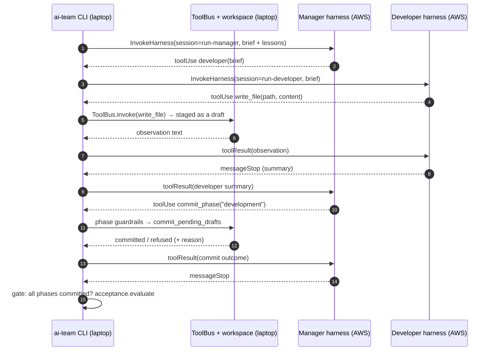

# Design: AWS Managed-Loop Backend (AgentCore Harness)

**Spec ID:** `aws-agentcore-harness` · **Read first:** [`requirements.md`](./requirements.md)

---

## 0. Where this sits

| Run | Framework | Who runs the loop | Model | Tools |
| --- | --- | --- | --- | --- |
| Step 0 | Claude SDK / LangGraph | our process | Bedrock `us.` profiles | ToolBus |
| `strands` | Strands | our process (or our container on AgentCore Runtime) | same | ToolBus |
| **`agentcore-harness`** | Strands, managed | **AWS** | same | ToolBus, via inline functions |

Only one thing changes between `strands` (local) and `agentcore-harness`: who owns the loop.

## 1. Components

```
src/ai_team/backends/agentcore_harness_backend/
  backend.py      # AgentCoreHarnessBackend(ThreadedBackend); target=cloud only
  client.py       # HarnessClient protocol; Boto3HarnessClient; FakeHarnessClient
  driver.py       # RoleSession: the turn loop for one role (stream → tool → result → repeat)
  tools.py        # BridgedTool → inline-function spec; specialist + commit_phase functions
  gate.py         # client-side phase gate (missing commit → follow-up turn → fail)
  usage.py        # metadata events → spend_guard.record_usage (per role)
  spans.py        # stream events → harness spans (llm_call, tool_use, tool_result, agent)
  config.py       # HarnessSettings: reads the Terraform `harness_config` JSON
infra/terraform/aws/modules/agentcore_harness/
infra/terraform/aws/modules/iam_harness/
```

## 2. How a run works



The laptop holds the workspace and runs every tool, including pytest and ruff, exactly as the
local backends do. AWS sees prompts and tool results; it never touches the workspace.

## 3. The turn loop (`driver.py`)

```python
def run_role(role: str, session_id: str, first_message: str) -> str:
    messages = [user(first_message)]
    while True:
        events = client.invoke(harness=cfg.endpoint(role), session_id=session_id, messages=messages)
        turn = collect(events)                     # text, toolUse blocks, metadata, stop reason
        usage.record(role, turn.metadata)          # priced, or observed_usd=None + warning
        spans.record_turn(role, turn)
        if not turn.tool_uses:                     # messageStop with no tool call: role is done
            return turn.text
        results = [run_tool(role, tu) for tu in turn.tool_uses]   # ToolBus.invoke, or child role
        messages = [tool_results(results)]         # only the new turn; history lives server-side
        guard.check()                              # spend + wall clock; raises to end the run
```

- `run_tool` for a specialist name calls `run_role(<specialist>, f"{run_id}-{specialist}-…", brief)`
  and returns its summary. This is agents-as-tools across harnesses.
- Never put a `toolUse` block as the last message of a request (the Harness rejects it). The
  loop only ever sends `toolResult` blocks or a user text turn.
- Several `toolUse` blocks in one turn are run in order, not in parallel, so the ToolBus audit
  order matches the model's order.

## 4. Tools as inline functions (`tools.py`)

```python
def inline_function(bt: BridgedTool) -> dict:
    return {"type": "inlineFunction", "name": bt.name,          # exact field names: pinned in 0.1
            "description": bt.description, "inputSchema": bt.json_schema}
```

| Role | Inline functions |
| --- | --- |
| manager | `architect`, `developer`, `qa`, `commit_phase` |
| architect | read-only tools from `bridged_tools_for_role("architect")` |
| developer | write tools for the developer role |
| qa | test tools for the QA role |

`allowedTools` lists exactly these names, so the built-in `shell` and `file_operations` can't
be chosen. The spike measures whether their definitions still cost input tokens on every turn
(reported as about 900); if they do, that overhead is priced and stated, not hidden.

## 5. Phase gate (`gate.py`)

The managed loop can stop whenever the model decides it's done. The gate makes that safe:

1. After the manager stops, compare committed phases with the plan from `common/roles.py`.
2. Missing phase → one user turn: "Phase `testing` is not committed. Call `qa`, then
   `commit_phase('testing')`." Up to `max_gate_retries` (2).
3. Still missing → end as `failed`, reason `phase_not_committed:<phase>`, run record closed.

This is the only orchestration code on our side, and it is deliberately small. If the managed
loop needs the gate often, that is a finding for the write-up.

## 6. Configuration

```yaml
# HarnessSettings (env prefix AI_TEAM_HARNESS_)
config_path: config/harness.dev.json   # written by `terraform output -json harness_config`
region: us-east-1                      # also read from the JSON; env wins
aws_profile: ai-team                   # standard AWS credential chain; no keys in .env
max_gate_retries: 2
run_budget_usd: 1.50                   # AI_TEAM_RUN_BUDGET_USD still applies
```

`harness_config` (Terraform output) carries, per role: endpoint ARN, harness version, model id,
and the inline-function names, so the client can check that its tool list matches what the
harness was deployed with and fail before spend if they drift.

## 7. Terraform

```hcl
module "harness" {
  count  = var.enable_agentcore_harness ? 1 : 0
  source = "../../modules/agentcore_harness"
  roles = {
    manager   = { model = var.model_manager,    prompt_file = "prompts/manager.md" }
    architect = { model = var.model_specialist, prompt_file = "prompts/architect.md" }
    developer = { model = var.model_specialist, prompt_file = "prompts/developer.md" }
    qa        = { model = var.model_specialist, prompt_file = "prompts/qa.md" }
  }
  tools_file         = "harness_tools.json"   # generated: `ai-team harness export-tools`
  execution_role_arn = module.iam_harness[0].execution_role_arn
  memory_enabled     = false
  limits             = { max_iterations = 40, max_tokens = 200000, timeout_seconds = 900 }
  truncation         = "sliding_window"
}
```

- **Prompts and tool lists come from the repo, not hand-edited in Terraform.** A small CLI
  command, `ai-team harness export-tools`, writes `harness_tools.json` and `prompts/*.md` from
  `common/roles.py` and the tool bridge. A prompt change means a new harness version through
  `plan` and `apply`, so it is visible and reversible.
- **Named endpoint per harness, pinned to its version.** `DEFAULT` auto-advances, which would
  let a run silently use a different prompt than the one recorded.
- `aws_bedrockagentcore_harness` needs `model` and `system_prompt` even though the API doesn't.
  Both are always set here, so that's harmless. If the resource is missing from the pinned
  provider, use `awscc` (`AWS::BedrockAgentCore::Harness`, `::HarnessEndpoint`) and record it
  in the ADR.

## 8. Telemetry mapping (`spans.py`)

| Harness stream event | ai-team span |
| --- | --- |
| a model turn (start to `messageStop` or tool stop) + `metadata` | `llm_call` (role, model, input and output tokens) |
| `toolUse` (inline function) | `tool_use` (name, arguments) |
| our `toolResult` | `tool_result` (observation, error flag) |
| one role session | `agent` (parent of the above) |
| `reasoningContent` blocks | not stored by default (size; may be enabled for debugging) |

Because the client sees every event, the harness view is complete without OTel. CloudWatch
holds AWS's view; the comparison follows the two-source rule.

## 9. Alternative not built: ToolBus as a hosted MCP server

ToolBus could run as an MCP server on AgentCore Runtime (or behind Gateway), with the workspace
in that runtime's session and synced to S3. That lets runs execute with no laptop involved,
but it moves the workspace and the audit log off the caller and adds a network hop on every
tool call. Revisit only if unattended cloud runs are needed; the inline-function design keeps
the comparison clean first.

## 10. Cost

- Tokens dominate, as for every backend: about $1–2 per thin slice on the Sonnet-class manager.
- Harness compute bills at the Runtime rates. CPU is not billed while the session waits on the
  model or on our tools, so four sessions per run cost about a cent or two.
- Possible extra: about 900 input tokens per model turn if built-in tool definitions can't be
  removed (spike 0.1). At ~40 turns per thin slice that's ~36k tokens, about $0.08 on the
  manager model.
- No idle cost between runs. Endpoints and harness definitions are free to keep.

## 11. Risks

| Risk | Mitigation |
| --- | --- |
| Harness API field names differ from this design | Spike 0.1 pins them; `client.py` is the only file that knows them |
| Inline-function round trips make runs slow | Measure in 3.1; latency per tool call goes in the write-up |
| The model stops before committing phases | Client-side gate (§5); repeated need is itself a finding |
| Terraform resource gaps or provider bugs | `awscc` fallback, recorded in the ADR |
| Endpoint advances to a new version mid-experiment | Named endpoints only; version recorded in every results bundle |
| Server-side history plus `sliding_window` truncation hides context from the model | Truncation recorded per run; compare with `none` once in Phase 3 |
| Prompts and tool results stored by AWS (session state, logs) | Memory off; log retention 14 days; no secrets in the workspace (existing guardrails) |
