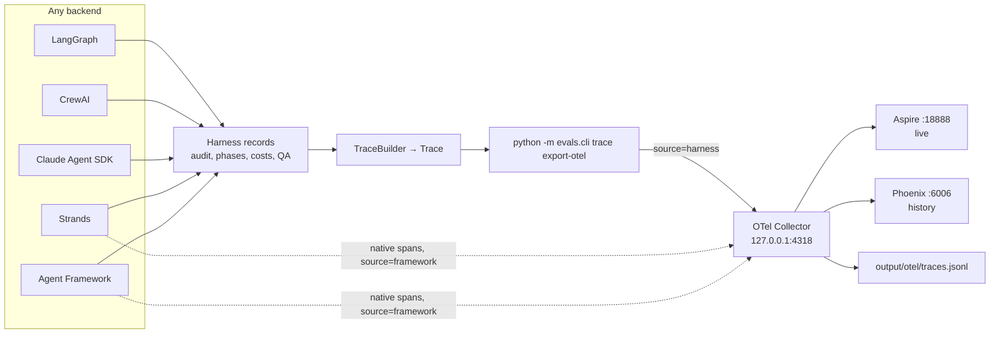

# Design: One OTel Shape for Every Backend

**Spec ID:** `otel-observability` · **Read first:** [`requirements.md`](./requirements.md)

---

## 0. Components and why each was chosen

Every piece this spec uses, what it is, and why it beat the alternatives. Versions are pinned
in task 0.2; licences are as of 2026-10-18 and are re-checked there.

### 0.1 Standards and formats

| Piece | What it is | Why we use it | Alternatives, and why not |
| --- | --- | --- | --- |
| **OpenTelemetry (OTel)** | The open, vendor-neutral standard for recording what software did: traces, metrics and logs. A CNCF project (the foundation behind Kubernetes). | Record once, view anywhere: AWS, Azure, Phoenix, Aspire and Datadog all read it. The two cloud backends already speak it. | Vendor formats (LangSmith, Datadog-native): lock-in, and they'd see only one framework. |
| **Trace / span** | A trace is one run; a span is one timed step in it (a model call, a tool call), with a parent, attributes and a status. ai-team's own `Trace` / `Span` models predate this spec. | The shared vocabulary between our records and every viewer. | — |
| **OTLP** | OTel's wire format for sending spans: protobuf or JSON, over gRPC (port 4317) or HTTP (4318). | The one protocol every collector and viewer accepts. | Zipkin or Jaeger formats: older, and not what the cloud services take. |
| **OTLP as JSON, not protobuf** | The same data as readable JSON. | Easy to read, diff and commit as fixtures; no protobuf dependency; the existing `import-otel` already reads it. | Protobuf: smaller and faster, which doesn't matter at hundreds of spans per run. |
| **GenAI semantic conventions** | OTel's agreed names for model, tool and agent steps (`gen_ai.operation.name`, `gen_ai.usage.input_tokens`, …). Still marked "development", so names can change. | Aspire, CloudWatch and Azure Monitor read them. | Our own names: no viewer would understand them. |
| **OpenInference** | An open (Apache 2.0) set of names for LLM traces, led by Arize and layered on OTel (`openinference.span.kind`, `llm.token_count.prompt`, …). | Phoenix's model, tool and agent views run on it; it's the shape decided on 2026-09-13. | GenAI names only: Phoenix shows plain generic spans. So both are written (R1.1). |
| **`schemaUrl`** | A field in OTLP naming the convention version the attribute names follow. | A reader a year from now knows which names were meant. | Nothing: silent drift when names change. |

### 0.2 Running pieces

| Piece | What it is | Why we use it | Alternatives, and why not |
| --- | --- | --- | --- |
| **`TraceBuilder`** (existing) | ai-team code that reads a run folder (ToolBus audit, phases, costs, QA verdicts) and builds one `Trace`. | The same record for every backend, which is the whole point of this spec. | Instrumenting each framework: five shapes, comparing instrumentation libraries, not backends. |
| **`export-otel`** (new) | Turns a `Trace` into OTLP JSON, with both naming schemes, and can send it to a collector. | A projection of the record we already trust. No OTel SDK in `src/`. | The OTel Python SDK inside the harness: a second telemetry system that has to agree with the first. Rejected 2026-09-13. |
| **`import-otel`** (existing, extended) | Turns OTLP JSON back into ai-team spans. | Lets framework spans be compared with ours; extended so our own exports read back exactly (R3). | — |
| **OTel Collector** (contrib build, Apache 2.0; already in compose) | A small relay that receives spans, processes them and fans them out to any number of destinations. | Viewers can be added or swapped by editing one YAML file, with no code change. It also keeps a raw file copy, and it's the same piece AWS and Azure run (ADOT, Azure Monitor). | Sending straight from `export-otel` to each viewer: every new viewer becomes a code change, and there's no raw copy. |
| **`memory_limiter`, `batch` processors** | Collector stages: the first stops it running out of memory on a burst; the second groups spans into fewer, larger sends. | The collector's own recommended baseline. | None: a 3,000-span backfill can stall it. |
| **`health_check` extension** | A collector endpoint that answers "ready". | Integration tests wait on it rather than guessing with sleeps. | Polling ports: flaky. |
| **.NET Aspire dashboard** (MIT, Microsoft; already in compose) | A single-container OTLP viewer: timeline, span details, and recent versions show GenAI fields. Keeps data in memory only. | Instant live view while a run executes, zero setup. | Keeping it as the only viewer: loses everything on restart and can't filter across runs. |
| **Arize Phoenix** (source-available, Elastic License 2.0; free to self-host) | An LLM-focused trace viewer in one container. Reads OpenInference, shows model calls with tokens, tool calls, and agent trees, and keeps history in a local database. | History across runs, filtering by backend and run, and LLM-aware views: what comparing five backends needs. Fits the OpenInference decision. | **Jaeger:** solid and generic, can diff two traces, but knows nothing about LLMs. **Grafana + Tempo:** strong dashboards across many runs, but 2–3 containers and more setup. **Langfuse (self-hosted):** a full LLM platform, but about five containers (Postgres, ClickHouse, Redis, storage). **SigNoz:** OTel-native, but heavy (ClickHouse). Any of them can be added later as one more collector exporter. |
| **Docker Compose `observability` profile** (existing) | A named group of services in the repo's compose file, started only when asked for. | Already holds the collector and Aspire; one command brings the stack up, and nothing runs otherwise. | A separate compose file: two files to keep in step. |
| **Localhost-only ports** (`127.0.0.1:`) | Each port is published on the loopback interface only. | Aspire and Phoenix have no login here, and traces can hold prompts and file contents. | Default `0.0.0.0`: anyone on the same network can read them. |

### 0.3 Choices inside the design

| Choice | Picked | Over | Because |
| --- | --- | --- | --- |
| What to export | The harness `Trace` | Native spans from each framework | The same shape for every backend; harness record is primary |
| Naming | OpenInference **and** GenAI on every span | Either one alone | Each viewer reads a different one; the cost is a few attributes |
| Content | Off by default; names, sizes and hashes only | On by default | Prompts and written files are sensitive; hashes still show "same file" |
| Ids | Hash of stable content | The builder's order-based `span_NNNN` | Re-sends don't duplicate; `--if-changed` works |
| Start/end pairs | Merged into one span with a duration, listed in `ai_team.span.merged` | Two zero-length spans | Viewers show durations; the list keeps re-import lossless |
| Delivery | Manual command and backfill now; auto-export optional later | Auto-export first | Auto-export needs every run path to finalize (methodology 1.7); backfill covers the need |

## 1. Shape of the change



## 2. Files

```
evals/trace/otel_export.py    # Trace → OTLP JSON; one mapping table; no OTel SDK
evals/trace/otel_import.py    # + honours ai_team.span.type / ai_team.span.merged; OTLP list-form
                              #   attributes; one OTLP request per JSONL line (R3)
evals/trace/otel_run.py       # export a run folder: file, POST, otel.export.json, --all (R2)
evals/cli.py                  # + `trace export-otel`
src/ai_team/harness/otel_tags.py   # run-id root-span helper; takes the framework's tracer as an argument
docker/docker-compose.yml     # + phoenix; ports bound to 127.0.0.1
docker/otel-collector.yaml    # + processors, health_check, phoenix exporter
Makefile                      # otel-up, otel-down, otel-backfill, test-otel-integration
docs/observability/README.md
# Phase 4 only:
src/ai_team/harness/otel_hook.py   # request_otel_export()
src/ai_team/config/settings.py     # + OtelExportSettings (AI_TEAM_OTEL_*)
```

## 3. Mapping

### 3.1 What the builder produces today (checked 2026-10-18)

- `llm_call` spans come from `costs.jsonl` rows that carry usage (`parsers.py`). They have zero
  duration (`t_start == t_end`). Per-call rows exist only where a backend reports them, which is
  what methodology R1.6 is about.
- `tool_use` / `tool_result` come from the ToolBus `audit.jsonl`.
- `phase_start` / `phase_end`, `qa_verdict`, `qa_disagreement`, `spend_event`, `guardrail_check`
  and others come from their own logs.
- After building, `_assign_span_ids` sorts spans and renames them `span_0000`, `span_0001`, …,
  so a builder id changes whenever an earlier span is added. Export ids must not use it (§5).

Task 0.1 confirms this per backend and finds the pairing keys below.

### 3.2 Merge rules

Viewers show durations, so some start/end pairs become one span. Each merged span lists what it
stands for in `ai_team.span.merged`, and the importer splits it back (R3).

| ai-team spans | Exported as | Pairing key (confirmed in 0.1) | Unpaired |
| --- | --- | --- | --- |
| `tool_use` + `tool_result` | one `execute_tool` span, start = use, end = result | the audit row's call id, or else (role, tool name, next result) | exported alone, `ai_team.unpaired = true` |
| `phase_start` + `phase_end` | one `phase <name>` span | phase name, in order | exported alone |
| `subagent_start` + `subagent_stop` / `session_start` + `session_end` | one `invoke_agent <role>` span | role / session id | exported alone |
| everything else | one span each, zero duration where the source has none | — | — |

**Parents:** a phase span is the parent of the spans inside its time window and phase; agent
spans sit under their phase; model and tool spans sit under their agent when the role matches,
else under the phase. The root is one `run` span per trace.

### 3.3 Attributes

| ai-team | OpenInference | GenAI | ai-team extras |
| --- | --- | --- | --- |
| `llm_call` | kind `LLM`, `llm.model_name`, `llm.token_count.prompt` / `.completion` | `chat`, `gen_ai.request.model`, `gen_ai.usage.input_tokens` / `output_tokens` | `ai_team.cost_usd`, `ai_team.tokens_missing` |
| `tool_use` / `tool_result` | kind `TOOL`, `tool.name`, `input.value` / `output.value` (content only) | `execute_tool`, `gen_ai.tool.name` | `ai_team.tool.args_sha256`, `ai_team.tool.result_bytes`, error status |
| agent / session | kind `AGENT`, `agent.name` | `invoke_agent`, `gen_ai.agent.name` | `ai_team.role` |
| phase, run | kind `CHAIN` | — | `ai_team.phase` |
| QA, guardrail, spend, smoke, retry, error | kind `CHAIN` | — | payload flattened under `ai_team.*` (content-gated) |

All spans carry `ai_team.span.type`, plus `ai_team.span.merged` when merged.

## 4. Content and size

- **Off (default):** no message text, no tool argument or result text. Keep names, byte sizes
  and a SHA-256, so two runs can still be compared ("same file written").
- **On (`--with-content`):** each text value is cut to 2 KB (`ai_team.truncated = true`).
- Payload keys that match the guardrail sensitive-file patterns (`.env`, credentials) are never
  exported, even with content on.

## 5. Ids and determinism

- OTel trace id = first 16 bytes of SHA-256(`run|<run id>`). Not the ai-team `trace_id`:
  `make_trace_id` adds a random suffix on every build, so it would change on every re-export
  (found while implementing 1.1).
- Span id = first 8 bytes of SHA-256(trace id, type, role, phase, `t_start` in ns, tool or model
  name, occurrence number among exact repeats).
- JSON is written with sorted keys and fixed number formatting, so the same trace gives the same
  bytes. That makes `--if-changed` meaningful and stops re-sends from duplicating spans.
- `schemaUrl` = the GenAI convention URL pinned in 0.2; the OpenInference version is recorded in
  `docker/VERSIONS.md`.

## 6. Payload census (task 0.1, done 2026-10-18)

Built with `TraceBuilder(backend=None)` from the newest run per backend in `output/runs/`, and
from the conformance thin slice of every registered backend.

| Source | Spans | Types | `llm_call` with tokens | Spans with a role | Phases |
| --- | --- | --- | --- | --- | --- |
| langgraph, `2026-09-18_224914_write-a-single-python-module_01` | 27 | tool_use 9, tool_result 9, qa_verdict 8, spend_event 1 | 0 of 0 | 2 of 18 tool spans; all 8 QA | none |
| claude-agent-sdk, `ws` | 28 | spend_event 28 | 0 of 0 | — | none |
| crewai, `2026-07-07_120536_create-a-simple-flask-rest-api_01` | 0 | — | — | — | none |
| conformance thin slice (crewai, langgraph, claude-agent-sdk, fake-remote) | 10 | llm_call 1, tool_use 4, tool_result 4, spend_event 1 | 1 of 1 (`usage`) | all tool spans | as `Span.phase` only |

**Payload keys seen:** `tool_use`: `tool`, `tool_name`, `agent_role`, `phase`, `run_id`,
`backend`, `kind`, `risk_class`, `timestamp`, `type`. `tool_result` adds `ok`, `code`,
`result`, `summary`, `artifact_refs`. `llm_call`: `usage`, `cost_usd`, `source`.
`spend_event`: `spent_usd`, `budget_usd`, `calls`, `total_tokens`, `kind`.

**Pairing keys (§3.2):** audit rows carry **no call id**. A `tool_use` pairs with the next
`tool_result` that has the same `tool`, `agent_role`, `phase` and `run_id`. No real run has
`phases.jsonl`, `sessions.jsonl` or subagent rows, so the phase and agent merge rules are
exercised only by unit fixtures for now.

**Missing for R1, and who owns it:**

| Gap | Effect on the export | Owner |
| --- | --- | --- |
| No `llm_call` spans in any real run (no per-call cost rows) | Real runs show tools and spend, no model calls | methodology R1.6 |
| `llm_call` payload has `usage` but no model id | `llm.model_name` filled from `session.json` `model_ids` when present, else omitted | methodology R1.8 |
| Most real tool spans have no `agent_role` | Tools hang under the run or phase span, not under an agent | ToolBus callers (not this spec) |
| Tool arguments are not logged (name, summary and artifact refs only) | Content gating applies to `summary`; nothing else to hide | — |

## 7. Local stack

```yaml
# docker-compose.yml, observability profile
otel-collector:
  ports: ["127.0.0.1:4317:4317", "127.0.0.1:4318:4318", "127.0.0.1:13133:13133"]
aspire-dashboard:
  ports: ["127.0.0.1:18888:18888"]
phoenix:
  profiles: ["observability"]
  image: arizephoenix/phoenix:<pinned in 0.2>
  ports: ["127.0.0.1:6006:6006"]
  volumes: ["../output/phoenix:/mnt/data"]
  environment: { PHOENIX_WORKING_DIR: /mnt/data }   # confirm the variable in 0.2
  networks: [aiteam]
```

```yaml
# otel-collector.yaml
extensions:
  health_check: { endpoint: 0.0.0.0:13133 }
processors:
  memory_limiter: { check_interval: 1s, limit_mib: 512 }
  batch: {}
exporters:
  otlphttp/aspire:  { endpoint: http://aspire-dashboard:18890 }
  otlphttp/phoenix: { endpoint: http://phoenix:6006 }
  file:             { path: /otel/traces.jsonl, append: true }
service:
  extensions: [health_check]
  pipelines:
    traces:
      receivers: [otlp]
      processors: [memory_limiter, batch]
      exporters: [otlphttp/aspire, otlphttp/phoenix, file]
```

- Ports bind to `127.0.0.1` because the viewers have no login and the traces can hold prompts.
- Aspire keeps traces in memory (live view). Phoenix keeps history and reads OpenInference.
  The file is a raw copy whatever viewer you use.

## 8. Optional, Phase 4: auto-export at run end

Built only after `eval-methodology-alignment` 1.7 makes every run path call
`ResultsBundle.finalize()`. Today the CLI paths for LangGraph and CrewAI don't
(`cli_run._finish_run`), so a hook there would silently miss them.

### 8.1 Constraints from the code

1. `src/` must not import `evals/` (`test_import_direction.py::test_src_does_not_import_evals`),
   and the wheel ships only `src/ai_team`.
2. `finalize()` may run more than once ("last call wins"), and it writes lessons and QA-verdict
   spans at its end, so the export must come after everything else.
3. The CLI exits right after a run; a background thread would die with it.
4. The Compare view ends three runs at once.

### 8.2 Decision: a detached child process running the same command

| Option | Why not, or why |
| --- | --- |
| In-process call | Breaks the import direction; adds the timeout to every run end |
| Background thread | Dies when the CLI exits; still breaks the import direction |
| Callback registry filled by `evals` | Only works if `evals` was imported in that process, which isn't true for CLI runs |
| **Detached child process** | Keeps the import direction; isolated; survives the parent exiting; reuses the manual command, so its tests cover it. Costs about a second of CPU per run |

### 8.3 The hook

```python
def request_otel_export(run_dir: Path, *, settings=None, spawn=subprocess.Popen) -> ExportRequest:
    """Start the exporter for one finished run. Never raises, never waits."""
```

1. Flag off → skip (the default).
2. `<repo root>/evals/__main__.py` missing (installed from the wheel) → skip, one warning. Don't
   use `find_spec("evals")`: under the `ai-team` console script the current directory isn't on
   `sys.path`, so it gives the wrong answer inside a checkout.
3. `logs/otel.export.lock` younger than 60 s → skip. Otherwise write it.
4. Spawn `[sys.executable, "-m", "evals.cli", "trace", "export-otel", run_dir, "--endpoint",
   url, "--if-changed"]` with `shell=False`, `cwd=<repo root>`, `stdin=DEVNULL`, output
   appended to `logs/otel.export.log` and `start_new_session=True`.
5. Any exception → warning, skip.

One call site: the last statement of `ResultsBundle.finalize()`. Settings (`AI_TEAM_OTEL_`
prefix): `EXPORT=0`, `ENDPOINT=http://localhost:4318`, `EXPORT_CONTENT=0`, `TIMEOUT_S=5`. No
retries: backfill is the retry.

### 8.4 Failure cases

| What goes wrong | Result | Recovery |
| --- | --- | --- |
| Collector down or slow | `written_only` after at most 5 s, in the child | `make otel-up`, `make otel-backfill` |
| Trace can't be built | `failed`, error in `otel.export.log` | Fix the builder; backfill |
| Wheel install | Skipped with a warning | Run from a checkout |
| `finalize()` twice | Lock plus `--if-changed`: one POST | — |
| Process killed before the child finishes | Lock expires in 60 s | Backfill |

## 9. Test plan

| Level | File | What it proves |
| --- | --- | --- |
| Unit | `tests/unit/evals/test_otel_export.py` | each mapping and merge row; both naming schemes; unpaired spans; parents; content off (sizes and hashes only) and on (2 KB cut); sensitive keys never exported; stable ids when a span is inserted earlier; identical bytes on repeat; `schemaUrl` |
| Unit | `tests/unit/evals/test_otel_import_roundtrip.py` | `ai_team.span.type` and `.merged` read back losslessly; framework spans unchanged; property test over random traces: same types, counts, roles, phases, start times |
| Unit | `tests/unit/evals/test_otel_export_cli.py` | file written; resource attributes; 1,100 spans arrive as 3 batches at a stub HTTP server on localhost; closed port gives a warning and exit 0; `--if-changed`; `--all` with one broken run; every `otel.export.json` status |
| Unit | `tests/unit/harness/test_otel_tags.py` | the helper sets `ai_team.run_id` on a fake tracer's root span |
| Repo | `tests/unit/repo/test_otel_stack_config.py` | Phoenix pinned (no `latest`); processors, health check and three exporters; every published port starts with `127.0.0.1:` (parsed with `yaml.safe_load`) |
| Conformance | `tests/conformance/test_otel_roundtrip.py` | for every registered backend's thin slice: export, then re-import, gives back the same trace |
| Integration | `tests/integration/test_otel_local_stack.py` | stack up via the health check; an exported fixture run reaches the file and Phoenix (via its HTTP API, pinned in 0.2); still there after a Phoenix restart; backfill over a temp `output/runs/` with one broken run; tears down; uses a temp `output/` |
| Phase 4 unit | `tests/unit/harness/test_otel_auto_export.py` | exact argument list, `shell` unused, `start_new_session`, each skip reason, lock window, swallowed spawn error; `finalize()` with the flag on returns and records the same as with it off |

Fixtures: no committed trace files. `tests/unit/evals/otel_helpers.py` builds small traces in
code, and the conformance suite supplies a real trace per backend. Files under
`evals/fixtures/traces/` would fall under the fixture contract (every file must be a check
fixture), so nothing is added there.

## 10. Risks

| Risk | Mitigation |
| --- | --- |
| Convention names change (GenAI is "development" status; OpenInference evolves) | Both pinned; one mapping table; the round-trip test |
| Phoenix ignores most `gen_ai.*` names | Since 15.10.0 it converts the main ones at ingest; OpenInference names are still written on every span (R1.1), and take precedence |
| Phoenix stores a re-sent span twice | Stable ids and `--if-changed`; 0.2 checks how Phoenix handles a repeated id |
| Pairing keys missing in some logs | Unpaired spans are exported alone and flagged, never dropped |
| Tool data leaks into viewers | Off by default, hashes only; 2 KB cut when on; sensitive keys never exported; ports bound to localhost |
| Very large runs | 512-span batches; the collector's `memory_limiter` |
