# Architecture

How ai-team is put together today: the backends, the shared harness they all run through, what
a run writes, and how runs become traces and eval results. Start here, then use:

| Next | For |
| --- | --- |
| [MODULE_MAP.md](MODULE_MAP.md) | Where every package and folder lives, and which way imports point |
| [EXTENDING.md](EXTENDING.md) | Adding a backend, tool, guardrail, role, eval check or spec |
| [CONFIGURATION.md](CONFIGURATION.md) | Every env var and CLI flag |
| [HARNESS.md](HARNESS.md) | Each harness layer's status, with the test that proves it |
| [GLOSSARY.md](GLOSSARY.md) | Terms |

Cloud-native backends (Strands on AgentCore, Agent Framework on Foundry), the
local/container/cloud target model, and the Terraform decision are in
[ADR-001](adr/ADR-001-cloud-native-backends.md); live status per target is in
[CLOUD_NATIVE.md](CLOUD_NATIVE.md).

---

## 1. The system at a glance

One nine-role team (manager, product owner, architect, three developers, DevOps, cloud
engineer, QA) runs on interchangeable orchestration backends. Everything around the agents
(tools, guardrails, spend limits, records) is shared, so a difference between runs can be pinned
to the framework, the model, the harness or the provider.

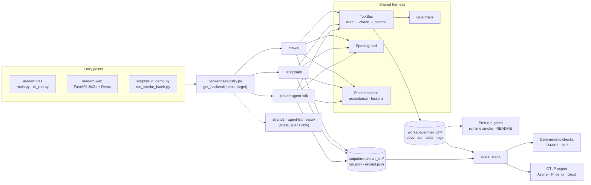

| Layer | Owner | One line |
| --- | --- | --- |
| Entry points | `main.py`, `cli_run.py`, `ui/web/`, `scripts/` | Parse a brief, a team profile and a backend name; start a run |
| Registry | `backends/registry.py` | Name + target → a `Backend` instance; refuses unsupported targets before any spend |
| Backends | `backends/<name>_backend/` | Run the agents with one framework; return a `ProjectResult` |
| Harness | `harness/`, `tools/`, `guardrails/`, `core/spend_guard.py` | Same tools, checks, limits and records on every backend |
| Records | `core/results/`, `harness/receipt.py` | Workspace files the agents hand off through; a bundle and receipt per run |
| Memory | `memory/`, `harness/lessons_loop.py` | Lessons from failed runs pinned into the next run's context |
| Evals | `evals/` (not shipped) | Runs → traces → checks, judges, Tier A gate, OTLP export |

## 2. A run, end to end

The CLI path. The web server and the demo scripts call the same `get_backend()` and
`backend.run()`.

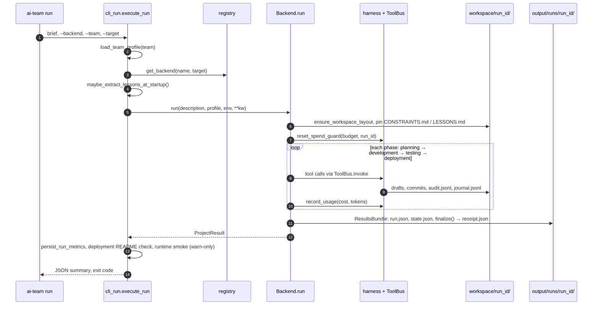

Notes on the steps:

- **Run identity.** Each run gets a readable id such as
  `2026-10-19_102648_write-a-single-python-module_01` (`core/run_naming.py`). The same id names
  the workspace and the bundle folder.
- **Phases** come from the team profile (`config/team_profiles.yaml`). `prototype`, `smoke` and
  `data-pipeline` skip deployment; `infra-only` runs planning and deployment only.
- **Spend.** `AI_TEAM_MAX_COST_PER_RUN` stops a run before it starts if the estimate is too
  high. `AI_TEAM_RUN_BUDGET_USD` stops it while running with a non-retryable
  `BudgetExceededError`. The guard is scoped per run with `contextvars`, so parallel runs in
  the web server do not share a counter.
- **Post-run gates** in `cli_run._run_post_run_quality_gates` run for every backend: the
  deployment README check when the profile has a deployment phase, and the runtime smoke gate
  (boot the generated app, drive a create/read/update/delete round trip over HTTP) when it has
  a testing phase. Both are warn-only. `AI_TEAM_SKIP_POST_RUN=1` skips them.
- **The receipt** (`output/runs/<run_id>/receipt.json`) is the source of truth for cost, files
  and smoke results. Live stream events are a progress view only.

## 3. Backends

### 3.1 Registry, protocol and targets

Every backend implements the `Backend` protocol in
[`core/backend.py`](../src/ai_team/core/backend.py): `run(description, profile, env, **kwargs)`
returns a `ProjectResult` ([`core/result.py`](../src/ai_team/core/result.py): `backend_name`,
`success`, `error`, `team_profile`, backend-specific `raw`), and `stream(...)` yields progress
events. `ThreadedBackend` provides `stream()` on top of a threaded `run()`.

| Name (`--backend`) | Class | Targets | State | Model access |
| --- | --- | --- | --- | --- |
| `crewai` (CLI default) | `CrewAIBackend` | local | Runs. Kept as a comparison datapoint; the flow runs in a spawned subprocess that is hard-killed at `CREWAI_HARD_TIMEOUT_SECONDS` | OpenRouter via LiteLLM |
| `langgraph` | `LangGraphBackend` | local | Runs. `placeholder` graph mode (no model calls) is the default; `full` runs the LLM subgraphs | OpenRouter |
| `claude-agent-sdk` (alias `claude-sdk`) | `ClaudeAgentBackend` | local | Runs | Anthropic API + Claude Code runtime |
| `strands` | `StrandsBackend` | local, container, cloud | Stub: raises `NotImplementedError` naming [aws-strands-agentcore](../.kiro/specs/aws-strands-agentcore/) | Amazon Bedrock (planned) |
| `agent-framework` | `AgentFrameworkBackend` | local, container, cloud | Stub: [azure-agent-framework](../.kiro/specs/azure-agent-framework/) | Microsoft Foundry (planned) |
| `fake-remote` | `FakeRemoteBackend` | all | Conformance test double, not public | none |

`--target` is `local`, `container` or `cloud` (`backends/common/targets.py`). The registry
rejects a target a backend does not support with `UnsupportedTargetError`, before any spend.

The executable definition of "a backend" is [`tests/conformance/`](../tests/conformance/):
every backend replays one scripted thin slice (`backends/common/thin_slice.py`) and must route
every tool call through the ToolBus, draft before committing, record spend, and write a
results bundle. How each framework fails, kept separate per incident: [FRAMEWORKS.md](FRAMEWORKS.md).

### 3.2 Orchestration shape per backend

| | **CrewAI** | **LangGraph** | **Claude Agent SDK** |
|--|------------|---------------|----------------------|
| **Primary state** | `ProjectState` in Flow | Checkpointed graph state | Session transcript + files under workspace |
| **Resume** | Flow rerun / new run | Thread id + `Command(resume=...)` | `session_id` + optional fork |
| **HITL** | Flow flags / human_feedback | `interrupt()` | `AskUserQuestion` + optional `can_use_tool` default answer |
| **Tool guardrails** | CrewAI task guardrails + Python validators | Guardrail nodes + shared helpers | SDK **hooks** (Pre/PostToolUse) + MCP tools |
| **Isolation** | Spawned subprocess, hard kill | In-process | In-process; Claude Code CLI child process |

### 3.3 Inter-agent communication

Every backend runs the same phases (intake → planning → development → testing → deployment), but
each moves work between agents differently. There are always **two** levels:

1. **Within-phase**: how a manager or coordinator hands work to specialists.
2. **Cross-phase**: how one phase's output reaches the next phase.

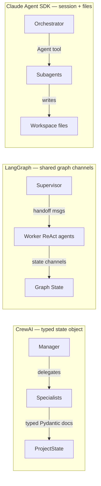

| | **CrewAI** | **LangGraph** | **Claude Agent SDK** |
|--|------------|---------------|----------------------|
| **What carries the message** | `ProjectState` + CrewAI task context | TypedDict state channels + workspace files | Session transcript + workspace files |
| **Manager → specialist** | `Process.hierarchical`, `manager_agent` delegates | `create_supervisor` handoff messages | Built-in `Agent` tool spawns subagents |
| **Specialist → next phase** | Typed docs written into `ProjectState` | Node returns dict; reducers merge channels | Files under `docs/` / `src/` / `tests/` |
| **Human-in-the-loop** | Flow flags / `human_feedback` | `interrupt()` + resume | `AskUserQuestion` / `can_use_tool` |

Companion figures: [overview](images/inter-agent-overview.svg),
[CrewAI](images/inter-agent-crewai.svg), [LangGraph](images/inter-agent-langgraph.svg),
[Claude SDK](images/inter-agent-claude-sdk.svg).

### 3.4 CrewAI backend

Code: `src/ai_team/backends/crewai_backend/` (`agents/`, `crews/`, `tasks/`, `flows/`).
`CrewAIBackend` starts `AITeamFlow` (a CrewAI `Flow[ProjectState]`) in a spawned subprocess.
The flow drives intake → planning → development → testing → deployment → finalize with
`@start()`, `@listen()` and `@router()`. Evals that need the flow's listener wiring import
`ai_team.core.flow_wiring`, not the flow package.

**Cross-phase:** `AITeamFlow` holds one `ProjectState`. Each crew's `kickoff()` takes the previous
phase's typed output and returns typed output, which the flow writes back. Example:
`development_crew.kickoff()` receives `RequirementsDocument` + `ArchitectureDocument` and returns
`list[CodeFile]` + `DeploymentConfig`.

**Within-phase:** hierarchical crews. The `manager_agent` (Manager for planning, Architect for
development) decides who does what. Specialists chain through task context
(`task.context = [prior_task]`) and hand off typed Pydantic docs (`output_pydantic`).

| Crew | Purpose | Key agents |
|------|---------|------------|
| **PlanningCrew** | Requirements and architecture | Manager (coordinator), Product Owner, Architect. Hierarchical |
| **DevelopmentCrew** | Generate and write code | Architect (coordinator), backend/frontend/fullstack developers, DevOps. Hierarchical |
| **TestingCrew** | Generate tests, run them, review code | QA Engineer. Sequential |
| **DeploymentCrew** | Docker, IaC, CI/CD, docs | Cloud Engineer → DevOps Engineer. Sequential |

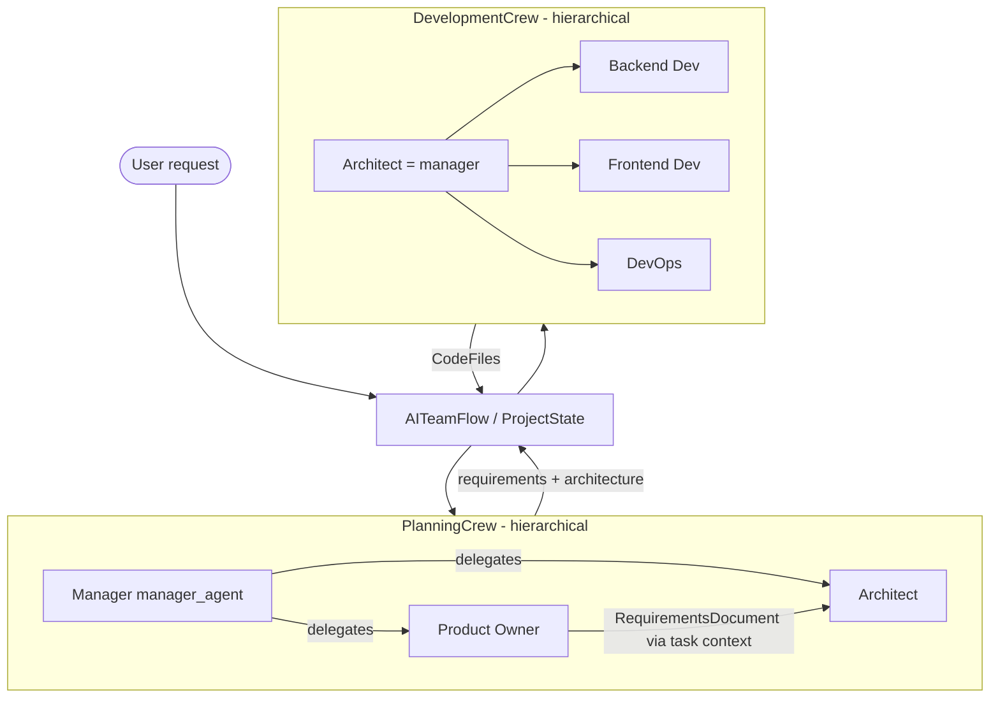

Routing after each crew step (`flows/routing.py`):

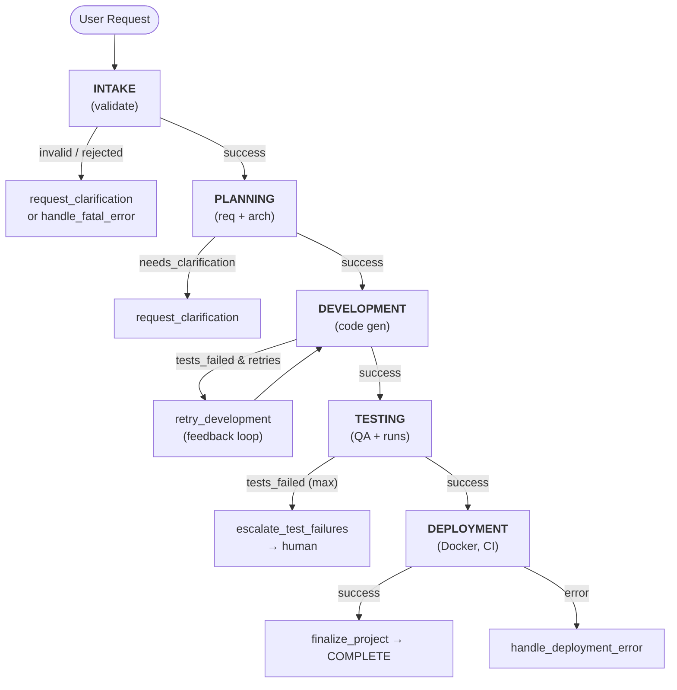

`ProjectState.current_phase` follows this state machine; `phase_history` records each
transition with a timestamp and reason.

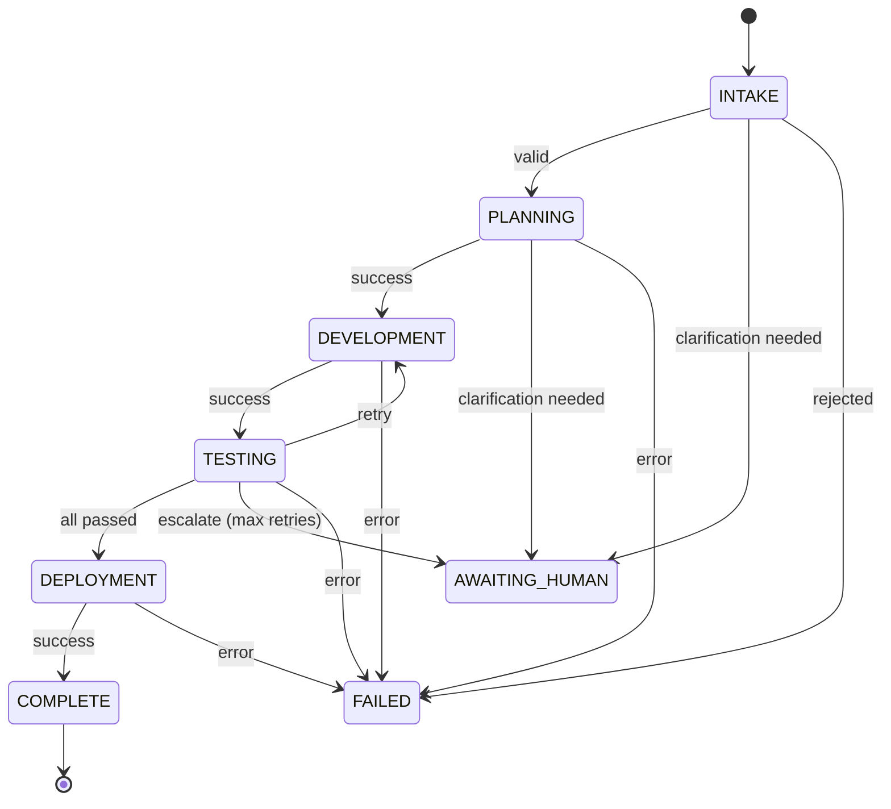

### 3.5 LangGraph backend

Code: `src/ai_team/backends/langgraph_backend/`. `LangGraphBackend` compiles the main graph in
`graphs/main_graph.py` with a checkpointer (`checkpointer.py`: in-memory or
`AI_TEAM_LANGGRAPH_SQLITE_PATH`, or Postgres via `AI_TEAM_LANGGRAPH_POSTGRES_URI`) and a
recursion limit (`AI_TEAM_LANGGRAPH_RECURSION_LIMIT`, default 50).

**Cross-phase:** a single `LangGraphProjectState` TypedDict flows through the graph
(`graphs/state.py`). Each node returns a dict of updates; reducers merge them into channels
(`generated_files` uses `operator.add`; `messages` uses `add_messages`). Conditional edges in
`graphs/routing.py` pick the next node. Checkpoints make `--resume` possible.

**Within-phase:** in `full` mode each phase node runs a subgraph built with
`langgraph-supervisor`. The supervisor (manager model) delegates to worker ReAct agents via
handoff messages on a shared `messages` channel. Only the new message delta from the subgraph is
merged back. Subgraphs also snapshot the disk, because models sometimes write files instead of
returning structured data. In `placeholder` mode the nodes are stubs and nothing is spent.

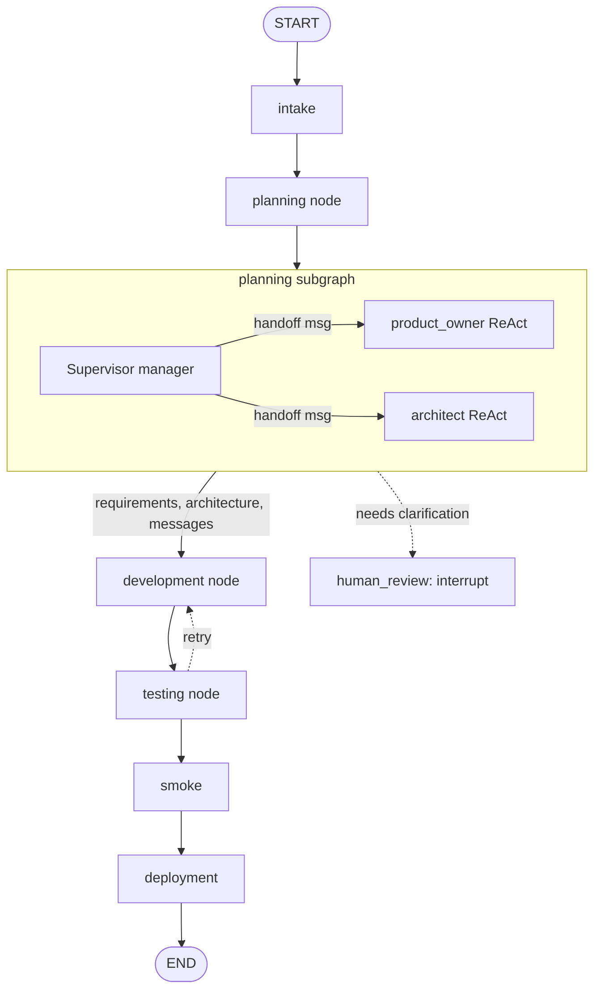

### 3.6 Claude Agent SDK backend

Code: `src/ai_team/backends/claude_agent_sdk_backend/` (`backend.py`, `orchestrator.py`,
`agents/`, `hooks/`, `tools/mcp_server.py`). The orchestrator builds `ClaudeAgentOptions`
(system prompt + repo `CLAUDE.md` + the per-run `<workspace>/docs/CLAUDE_PROFILE.md`),
registers the in-process `ai_team_tools` MCP server (guardrails, pytest, smoke), and streams or
runs until a `ResultMessage`. After a clean run it boots the generated app and, if the probe
fails, retries with the defect (`ANTHROPIC_SMOKE_LOOP_ENABLED`).

**Cross-phase:** there is no typed state object. One long-lived `query()` session runs; the
orchestrator's system prompt is the Manager. It delegates to subagents (`AgentDefinition` map
from `agents/builder.py`) through the SDK's built-in `Agent` tool. The durable handoff between
phases is the workspace (`docs/`, `src/`, `tests/`, `logs/`).

**Within-phase:** subagents are nested. Phase agents (`planning-agent`, `development-agent`,
`deployment-agent`) act as the Manager for their phase and delegate to the specialists in the
profile.

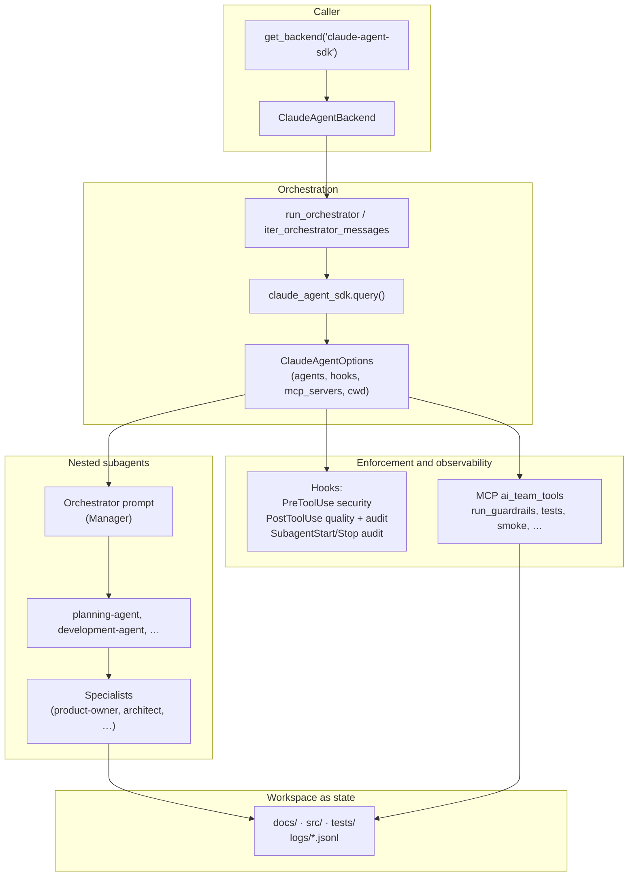

Native `Write` and `Bash` are allowed unless `AI_TEAM_DENY_NATIVE_TOOLS` is set; in that mode
writes go through the MCP tools and the ToolBus. Operator steps (env vars, budget, recovery):
[claude-agent-sdk/RUNBOOK.md](claude-agent-sdk/RUNBOOK.md).

### 3.7 Planned cloud backends

`strands` (Strands Agents on Amazon Bedrock AgentCore) and `agent-framework` (Microsoft Agent
Framework on Microsoft Foundry) exist as stubs that satisfy the conformance suite through the
scripted thin slice and raise `NotImplementedError` otherwise. They will reuse the shared
role prompts (`backends/common/roles.py`) and ToolBus-backed tools (`backends/common/tool_bridge.py`),
emit their own OpenTelemetry spans tagged by `harness/otel_tags.py`, and deploy with
`infra/terraform/`. Plans: [cloud-backend-foundation](../.kiro/specs/cloud-backend-foundation/),
[aws-strands-agentcore](../.kiro/specs/aws-strands-agentcore/),
[azure-agent-framework](../.kiro/specs/azure-agent-framework/),
[aws-agentcore-harness](../.kiro/specs/aws-agentcore-harness/). AWS options and costs:
[AWS_BACKEND_ARCHITECTURE.md](AWS_BACKEND_ARCHITECTURE.md).

## 4. The shared harness

The harness is the part that is identical on every backend. Its seven layers, the module that
owns each, and whether each is instrumented, enforced or closed-loop are tracked in
[HARNESS.md](HARNESS.md). The pieces a newcomer meets first:

| Piece | Module | What it does |
| --- | --- | --- |
| **ToolBus** | `tools/bus.py`, `tools/catalog.py`, `tools/kinds.py` | The only execution path for tools. Validates args against a schema, checks the caller's role, then branches on `kind`: reads run, writes are staged as drafts (`tools/draft.py`) until committed, irreversible actions need a token. Every call lands in `logs/audit.jsonl` and `logs/journal.jsonl` |
| **Tool bridge** | `backends/common/tool_bridge.py`, `role_tools.py` | One role → tools map for every backend; frameworks get schemas and callables that go through the bus |
| **Guardrails** | `guardrails/` | Behavioral (role adherence, scope), security (code safety, secrets, PII, prompt injection, paths), quality (code quality, coverage, docs, deployment README, runtime smoke). Wired per backend; see the table below |
| **Spend guard** | `core/spend_guard.py` | Per-run budget, scoped with `contextvars`; `BudgetExceededError` subclasses `BaseException` so retry loops cannot swallow it |
| **Pinned context** | `harness/context.py` | `docs/CONSTRAINTS.md` is injected unchanged on every prompt; `STATE.md` holds the last phase facts; `LESSONS.md` is rendered from the lesson store |
| **Acceptance** | `harness/acceptance.py`, `backends/common/acceptance.py` | Harness-owned acceptance list (`logs/harness_acceptance.json`); a run's acceptance does not depend on a QA tool's opinion |
| **Receipt and journal** | `harness/receipt.py`, `harness/journal.py`, `harness/telemetry.py` | `receipt.json`/`receipt.md` at finalize; append-only journal of ToolBus decisions |
| **Routing** | `harness/router.py`, `config/task_routes.yaml` | Task-typed model routing (cheap deterministic path vs model) |
| **Runtime smoke** | `tools/smoke_tools.py`, `harness/verifiers.py` | Boot the generated app and probe it over HTTP; catches "tests green, app broken" |

Where each backend enforces guardrails:

| Backend | Enforcement point |
| --- | --- |
| CrewAI | Task `guardrail=` callables in `crewai_backend/tasks/` and class guardrails in `guardrails/legacy.py` |
| LangGraph | Guardrail nodes with retry routing (`graphs/langgraph_guardrail_nodes.py`) and message checks (`graphs/guardrail_hooks.py`) |
| Claude Agent SDK | PreToolUse/PostToolUse hooks (`hooks/security.py`, `hooks/quality.py`) and the `run_guardrails` MCP tool |
| All | ToolBus path checks on every write; post-run deployment README and runtime smoke checks in `cli_run.py` |

Configuration toggles: [CONFIGURATION.md](CONFIGURATION.md#guardrails). Catalogue and tuning:
[GUARDRAILS.md](GUARDRAILS.md).

### 4.1 Memory and the lessons loop

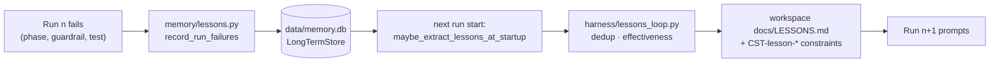

The store is SQLite (`MEMORY_SQLITE_PATH`, default `./data/memory.db`). Extraction is
deterministic, with no model calls. The same file holds web run history (`core/run_store.py`)
and per-run KPIs (`persist_run_metrics`). Earlier ChromaDB short-term memory, entity memory and
RAG were removed; CrewAI may still use its own internal storage when that backend runs. More:
[SELF_IMPROVEMENT.md](SELF_IMPROVEMENT.md).

## 5. What a run leaves behind

| Folder | Role | Key files |
| --- | --- | --- |
| `workspace/<run_id>/` | The agents' working copy and the handoff surface between agents | `docs/` (brief, requirements, architecture, `CONSTRAINTS.md`, `STATE.md`, `LESSONS.md`), `src/`, `tests/`, `infrastructure/`, `logs/` (`audit.jsonl`, `journal.jsonl`, `phases.jsonl`, `costs.jsonl`) |
| `output/runs/<run_id>/` | The record: written by `ResultsBundle` and the harness | `run.json`, `state.json`, `receipt.json`, `receipt.md`, `artifacts/<phase>/`, `reports/`, `logs/` |

Full layouts: [MODULE_MAP.md](MODULE_MAP.md#per-run-directories) and
[RUN_ARTIFACTS.md](RUN_ARTIFACTS.md). Delete old runs with `delete_run()` / `prune_runs()` in
`core/results/cleanup.py` or `DELETE /api/runs/{id}` ([GETTING_STARTED.md](GETTING_STARTED.md#deleting-old-runs)).

## 6. Web dashboard and monitor

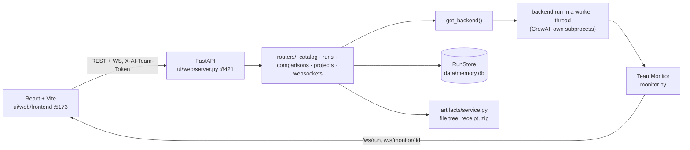

- `ai-team-web` binds `127.0.0.1:8421`. Binding any other host requires `AI_TEAM_WEB_TOKEN`
  (`ui/web/auth.py`); threat model in [SECURITY.md](../SECURITY.md).
- A run continues if its `/ws/run` socket closes; the Compare tab launches one socket per
  backend with a shared `comparison_id`.
- Cost, files and smoke results on a finished run come from `receipt.json`
  (`GET /api/runs/{id}/receipt`), not from the live event stream.
- `TeamMonitor` is the same collector behind the CLI `--monitor` view.

## 7. Evals, traces and OpenTelemetry

`evals/` turns runs into immutable `Trace` objects and scores them. It imports `ai_team`
contracts but `src/ai_team` never imports it, so a run never depends on eval code.

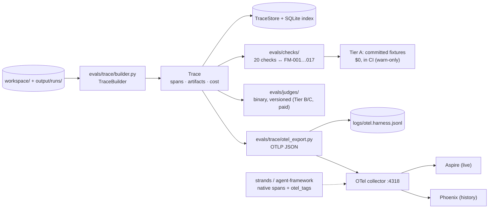

- Method (error analysis first, checks before judges): [EVAL_METHODOLOGY.md](EVAL_METHODOLOGY.md).
- What Tier A proves today: [EVAL_GATE_STATUS.md](EVAL_GATE_STATUS.md).
- Commands and layout: [evals/README.md](../evals/README.md).
- Viewing traces locally (`make otel-up`, `make otel-backfill`) and in AWS/Azure:
  [observability/README.md](observability/README.md). Spec:
  [otel-observability](../.kiro/specs/otel-observability/).

## 8. Technology stack

| Layer | Technology | Purpose |
|-------|------------|---------|
| Orchestration | CrewAI Flows, LangGraph, Claude Agent SDK (Strands, Agent Framework planned) | Backends behind one `Backend` protocol |
| Models | OpenRouter (CrewAI, LangGraph), Anthropic API (Claude SDK), Bedrock / Foundry (planned) | Per-role models via `AI_TEAM_ENV` and profile overrides ([MODELS.md](MODELS.md)) |
| State and schemas | Pydantic | `ProjectState`, `ProjectResult`, results bundle, ToolBus requests and observations, guardrail results |
| Persistence | SQLite | Long-term memory, lessons, run history, LangGraph checkpoints (Postgres optional) |
| UI | FastAPI + React/Vite | Run, compare, browse artifacts; Rich `--monitor` on the CLI |
| Config | pydantic-settings | Settings from `.env` and the environment ([CONFIGURATION.md](CONFIGURATION.md)) |
| Logging | structlog | Structured logs |
| Telemetry | OTLP JSON (no SDK dependency in `src/`), OTel collector, Aspire, Phoenix | Trace viewing |
| Infra | Docker, Terraform | Images and cloud deployment for the cloud backends |

---

## 9. Architecture Decision Records

The records below were written inline before `docs/adr/` existed. Their numbers are a separate
series: [docs/adr/ADR-001](adr/ADR-001-cloud-native-backends.md) (cloud-native backends) is not
the inline ADR-001 below.

### ADR-001: Why CrewAI Flows over LangGraph

**Status:** Superseded by ADR-004, ADR-005, and ADR-006

> **Note (current state):** This ADR records the *original* decision to build on CrewAI Flows first. It is kept for the historical record. The project has since moved to a **multi-backend architecture** behind one `Backend` protocol (ADR-005), where CrewAI, LangGraph, and the Claude Agent SDK are peers selected with `--backend`. CrewAI is now a comparison datapoint; see §3.1. Do not read this ADR as "CrewAI is the primary engine".

**Context:** We need an orchestrator that coordinates multiple crews (planning, development, testing, deployment) with shared state, conditional routing, and human-in-the-loop.

**Decision (at the time):** Use **CrewAI Flows** as the initial orchestration layer.

**Rationale:**

- **Native crew integration:** Flows are designed to trigger and consume CrewAI crews; state can be passed via a single Pydantic model (ProjectState).
- **Declarative routing:** `@router()` and `@listen()` make phase transitions and branches explicit (e.g. retry development vs escalate).
- **Simpler mental model:** Event-driven flow with a single state object is easier to reason about and test than a generic graph.
- **Ecosystem fit:** Agents, tasks, tools, and memory are already CrewAI concepts; one stack reduces integration cost.

**Consequences:** We depend on CrewAI’s Flow API and lifecycle. If we need very custom graph semantics later, we can still wrap or replace the flow implementation while keeping the same state and crew contracts.

---

### ADR-002: Why OpenRouter for LLM and Embeddings

**Status:** Accepted

**Context:** Agents need an LLM and embedding backend; we want a single API key, multiple models per role, and no local GPU requirement.

**Decision:** Use **OpenRouter** as the provider for the CrewAI and LangGraph backends.

> **Note (current state):** The Claude Agent SDK backend (ADR-006) runs on the **Anthropic API** with `ANTHROPIC_API_KEY`, not OpenRouter. Provider choice is per backend: OpenRouter for CrewAI/LangGraph, Anthropic for the SDK, Bedrock and Foundry for the planned cloud backends.

**Rationale:**

- **Single key:** One `OPENROUTER_API_KEY` for chat and embeddings across the OpenRouter-based backends.
- **Model choice:** Different models per role via `OpenRouterSettings` and `AI_TEAM_ENV` (dev/test/prod).
- **No local GPU:** No local model setup; works in CI and on any host with network.

**Consequences:** The OpenRouter backends require network and an OpenRouter account; the SDK backend requires an Anthropic key instead. See `.env.example` and [GETTING_STARTED.md](GETTING_STARTED.md).

---

### ADR-003: Why Hierarchical Process for Planning and Development Crews

**Status:** Accepted

**Context:** Planning and development involve multiple agents (e.g. Manager, Product Owner, Architect; Manager, Backend, Frontend). We need coordination and delegation without ad hoc handoffs.

**Decision:** Use a **hierarchical process** for PlanningCrew and DevelopmentCrew, with the **Manager** as `manager_agent`.

**Rationale:**

- **Single coordinator:** The Manager assigns tasks, resolves conflicts, and escalates to human when needed, which matches the “engineering manager” role in the design.
- **Structured delegation:** CrewAI’s hierarchical process provides a clear pattern: manager decides “who does what” and aggregates results, reducing duplicate or conflicting work.
- **Scalability:** Adding more specialists (e.g. another developer type) only requires adding an agent and tasks; the Manager’s role stays the same.
- **Traceability:** Manager’s decisions and status updates can be logged and reflected in ProjectState for observability.

**Consequences:** The Manager agent must be capable of task decomposition and routing; it should use tools like task_delegation and status_reporting. Testing and Deployment crews can remain simpler (e.g. single primary agent or small flat crew) since they have fewer concurrent roles.

---

### ADR-004: LangGraph as an alternative orchestration backend

**Status:** Accepted

**Context:** CrewAI Flows cover the primary multi-crew pipeline. Some workflows benefit from explicit graph semantics, first-class checkpointing, and streamable node updates for CLI/TUI/web dashboard.

**Decision:** Add an optional **LangGraph** backend (`LangGraphBackend`) that compiles a main graph with phase-aligned nodes, conditional routing, guardrail nodes, and optional subgraphs for planning/development/testing/deployment.

**Rationale:** Same `ProjectResult` contract; enables `--resume` after interrupts; integrates with existing team profiles without duplicating agent definitions in graph code (subgraph runners consume profile-aware tools).

**Consequences:** Two code paths to maintain; LangGraph subgraphs that call LLMs must stay aligned with CrewAI tool/guardrail behavior. Comparison tooling (`scripts/compare_backends.py`) helps validate parity on demos.

---

### ADR-005: Multi-backend architecture and team profiles

**Status:** Accepted

**Context:** Users need to swap orchestration engines and team composition without forking the repository.

**Decision:** Centralize backend selection in `get_backend(name)` and team composition in `load_team_profile(team)`. CLI flags: `--backend`, `--team`. CrewAI, LangGraph, and Claude Agent SDK backends receive the same `TeamProfile` and project description string.

**Rationale:** One configuration surface (`team_profiles.yaml`); demos and comparison scripts exercise all three backends with identical inputs.

**Consequences:** New backend features should be reflected across the backends when parity matters, or documented as backend-specific.

---

### ADR-006: Claude Agent SDK backend — session transcript vs typed graph state

**Status:** Accepted

**Context:** CrewAI Flows and LangGraph keep **structured application state** (`ProjectState`, checkpoint tuples) that UIs and tests can inspect. The Claude Agent SDK instead runs a **long-lived agent session** with tool calls and optional nested subagents; Anthropic does not expose the same graph-shaped state model.

**Decision:** Treat the **Claude session** (plus optional resume/fork) as the continuity mechanism, and the **workspace directory** (`docs/`, `src/`, `tests/`, `logs/`) as the **durable handoff surface** between phases—mirroring the file-based pattern already used for crew outputs. Map the same `TeamProfile` into `AgentDefinition` subagents; do not require `ProjectState` inside the SDK path.

**Rationale:** Aligns with how the SDK is designed to work (orchestrator delegates via the `Agent` tool; specialists have isolated contexts). Avoids maintaining a parallel state machine that would fight the session transcript. Enables resume with `session_id` and cost/session logs in JSONL for observability.

**Consequences:** Feature parity with LangGraph HITL differs (`interrupt()` vs `AskUserQuestion` / `can_use_tool`). Comparison scripts and UIs must read Claude outcomes from `ProjectResult.raw` and workspace artifacts, not from a shared Pydantic flow state. Document backend-specific flags in the Claude runbook.

---

### ADR-007: Hooks as guardrails — PreToolUse / PostToolUse / subagent audit

**Status:** Accepted

**Context:** Prompt-only instructions can be ignored under pressure; CrewAI/LangGraph use task guardrails and Python validators. The Claude Agent SDK exposes **hooks** that run around tool use and subagent lifecycle.

**Decision:** Register **PreToolUse** hooks for path/shell patterns (block traversal, sensitive paths, risky `Bash`), **PostToolUse** hooks for lightweight quality signals (e.g. TODO markers in new Python), and **append-only JSONL audit** hooks for tool events plus **SubagentStart** / **SubagentStop**. Keep heavy checks available via the **MCP** `run_guardrails` and related tools so agents can opt in per file.

**Rationale:** Hooks provide **deterministic enforcement** on every matching tool call without waiting for an LLM to self-correct. Subagent audit aids debugging multi-agent sessions. Splitting “always-on” hooks vs “on-demand” MCP avoids redundant work and keeps hook latency low.

**Consequences:** Hook matchers must be maintained when Claude Code adds or renames tools. Behavior is not identical to CrewAI `GuardrailResult` tasks—document differences in tests and the Claude SDK plan. False positives in PostToolUse may require tuning or allow-lists over time.
