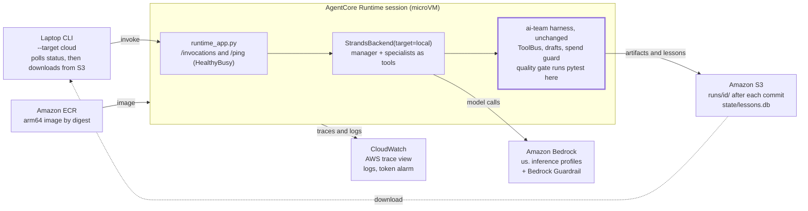
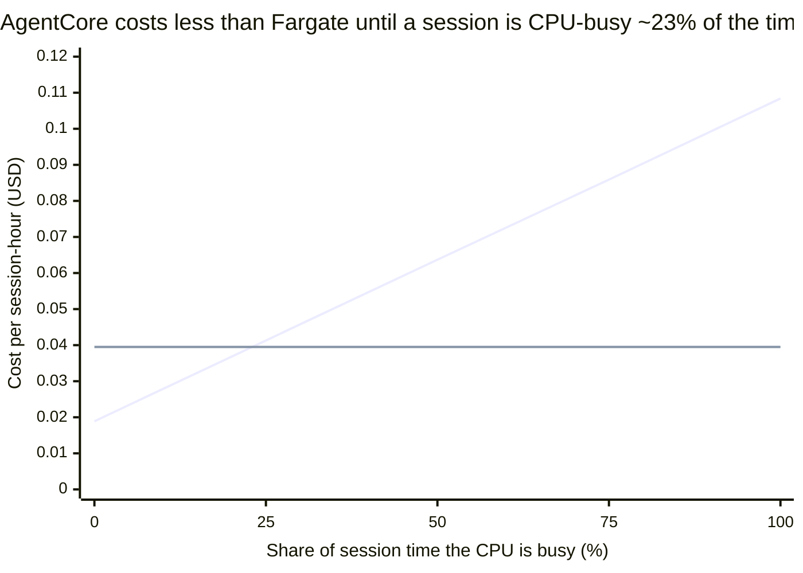
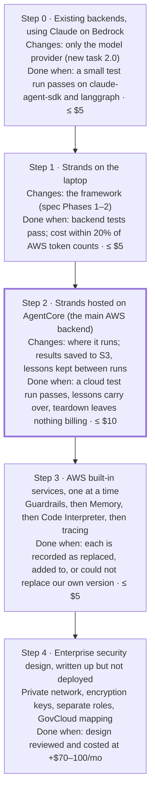

# AWS Backend Architecture

Oct 18, 2026 · @Rick

## TL;DR

The spec's target — Strands on AgentCore Runtime, Terraform, harness unchanged — is the right destination. But going straight there changes three things at once: framework, model provider and host. If the finish rate moves, you won't know which one moved it. So build it in steps, changing one thing at a time.

1. **Step 0 — same backends, Claude on Bedrock.** Point the existing `claude-agent-sdk` backend at Bedrock (`CLAUDE_CODE_USE_BEDROCK=1`). It's config only, about a day of work and under $5. Only the model provider changes, so every later AWS result has this one to compare against.
2. **Step 1 — Strands on the laptop, using Bedrock** (spec Phases 1–2). Only the framework changes.
3. **Step 2 — the same code, hosted on AgentCore Runtime**, public network mode, with S3 artifacts and the lessons DB snapshotted to S3 (spec Phases 3–4, plus one new task). Only where the code runs changes.
4. **Step 3 — AWS's built-in services, tested** one at a time: Bedrock Guardrails, AgentCore Memory, Code Interpreter, Observability.
5. **Step 4 — enterprise security and compliance** (VPC mode, KMS, Policy, GovCloud). Write it up as a design; don't build it under a $25 budget, because VPC endpoints alone cost more than that.

The plan has four defects to fix before Cursor starts, all in the review below:

- The pinned `hashicorp/aws` provider predates the AgentCore resources.
- A cloud run silently breaks the closed lessons loop.
- IAM least privilege has to cover cross-region inference profiles.
- The ±20% cost check can't be done against the billing console the same day.

Compute is not a cost decision here. A full run costs about a cent of AgentCore compute against roughly $1 of tokens.

## Review of the current plan

The spec (`.kiro/specs/aws-strands-agentcore`, 0 of 30 tasks done) is structurally sound. Its local-first gating, deploy-by-digest, image-as-the-unit and two independent trace sources are all the right calls. What it gets wrong is mostly facts that changed under it, or facts it never checked. The foundation it depends on is in place: the conformance suite, tool bridge, harness acceptance, compose profiles, the `strands_backend` placeholder, and Terraform module stubs (only `budget` has resources).

### What holds

- **Harness stays authoritative.** ToolBus, draft-then-commit and spend guard all stay in-process inside the container, so AgentCore hosts the harness rather than replacing it. This is the decision that keeps the comparison honest.
- **The image is the unit.** The AgentCore contract is small: HTTP on port 8080, `POST /invocations` and `GET /ping`, linux/arm64. The `container` target can therefore exercise the exact cloud code path on the laptop at $0.
- **The long-run mechanism exists, as the spec guessed.** `/ping` returns `HealthyBusy` while background work runs, through `app.add_async_task()` / `complete_async_task()`. A `Healthy` session idle for 15 minutes is reaped, and async work can run up to 8 hours. A 26-minute nine-role run fits easily. The one trap is a blocking call in the entrypoint: it can starve `/ping` and get the session killed. `runtime_app.py` must run the pipeline in a worker thread.
- **Agents-as-tools over swarm.** This is still right. Strands' `AgentAsTool` (v1.34+) now auto-wraps an `Agent` passed in `tools=`, which removes boilerplate from `agents.py`.

### What breaks, and the fix

| # | Issue | Why it matters | Fix (task) |
| --- | --- | --- | --- |
| 1 | `versions.tf` pins `hashicorp/aws` **5.100.0**. The `aws_bedrockagentcore_*` resources shipped in the 6.x line (CDKTF `provider-aws` 21.x carries them). | Task 3.4 can't validate. `validate` passes today only because the modules are empty. | 0.1: pin the first 6.x release that has `agent_runtime`, `memory` and `code_interpreter`, and move all modules together. Run `terraform providers schema -json \| jq` in the spike to prove it. |
| 2 | The lessons loop is SQLite on local disk. An AgentCore session is a microVM with an ephemeral filesystem. | Cloud run *n* can't change run *n+1*. HARNESS.md's "closed-loop" claim would be silently false on `target=cloud`, which is the same class of defect as September's 135-reject finding. | New 4.0: on invocation, pull `lessons.db` from `s3://…/state/`; on completion, push it back with an `If-Match` ETag (S3 conditional writes) so concurrent runs can't clobber each other. Add a conformance assertion that lessons persist across two `container` runs with a fresh container each time. |
| 3 | Newer Claude models on Bedrock are invoked through cross-region **inference profiles** (`us.` / `global.`). | The "only these model ARNs" policy in 3.2 gets `AccessDenied` at run time. A profile call needs both the inference-profile ARN and the foundation-model ARN in every destination region. | 3.2: one statement per model, listing the profile ARN plus `arn:aws:bedrock:*::foundation-model/<id>`, with a `bedrock:InferenceProfileArn` condition. The `terraform test` asserts the pairing. |
| 4 | The ±20% cost check compares to "the Bedrock console". Cost Explorer lags by about 24 hours, and a run under $1 is lost in rounding. | Task 2.2 can't close in the session that runs it. | 2.2: compare against the CloudWatch `AWS/Bedrock` `InputTokenCount` / `OutputTokenCount` metrics for the run window, priced by our table. Billing becomes a next-day reconciliation note. |
| 5 | Artifacts upload to S3 only "when done". | A run killed at minute 20 (budget, timeout, microVM reaped) leaves nothing to grade, yet `budget_exceeded` and `timeout` are conformance outcomes. | R5.1.3: sync the workspace on every `commit_pending_drafts`, and always sync `logs/` in a `finally`. |
| 6 | The spec predates the **AgentCore Harness** (GA June 2026). It's a config-only managed agent loop built on Strands, with export to code. | It's the cheapest possible AWS-native baseline, and a reviewer will ask why it isn't in the comparison. | Add it as architecture E below, as an optional extra step. Don't make it the backend: tools would have to leave ToolBus. |
| 7 | Step 0 isn't in the plan. | Without it, a Strands-vs-LangGraph difference can't be told apart from an OpenRouter-vs-Bedrock one. | New 2.0. `orchestrator.py:264` hard-requires `ANTHROPIC_API_KEY`; allow `CLAUDE_CODE_USE_BEDROCK=1` plus the AWS profile instead. LangGraph and CrewAI reach Bedrock through LiteLLM `bedrock/…` ids, but `llm_factory.py` assumes OpenRouter ids. |
| 8 | Task 0.2 says "request model access". | Bedrock moved to default-on serverless model access. Anthropic models still need a one-time use-case form per account. | 0.2: submit the Anthropic use-case form. Then verify with a `bedrock-runtime converse` call, not by checking the console. |
| 9 | Observability needs CloudWatch **Transaction Search** turned on once per account. | Without it, AgentCore spans don't appear and 4.2's screenshot can't happen. | 3.6: `aws_xray_resource_policy` plus `aws_cloudwatch_log_resource_policy` and the Transaction Search setting, in the `observability` module. |
| 10 | The `PUBLIC` network mode gives generated code outbound internet while pytest runs. | It's acceptable in a dev account, but it's an exfiltration path, and it needs to be named in the security write-up. | Step 4 covers private networking with no internet access. Pre-bake the test dependencies into the image so the no-egress option stays open. |

Items 1, 2 and 7 are the ones that would cost a week if found late. The rest are under an hour each.

## Architectures

Six candidates, ordered from least to most AWS-native. C is the spec's target and the recommended baseline. A and B are the earlier steps that make C's results meaningful. D and E are what "AWS-native" can mean beyond C. F runs the same code on plain AWS containers, to check whether AgentCore is worth it.

| Arch | One line | Build effort | Fixed $/mo | Changes vs. existing backends | Comparison value |
| --- | --- | --- | --- | --- | --- |
| A · Bedrock as model provider | Existing backends, Bedrock endpoint | \~1 day | $0 | model provider only | High: the baseline |
| B · Strands in-process | New backend on the laptop, Bedrock models | \~1 week | $0 | + framework | High: tests the framework alone |
| C · Strands on AgentCore Runtime | Same image, hosted microVM per session | \~1–2 weeks after B | \~$1–3 | + host | High: the spec's target |
| D · AgentCore full-native | C + Memory, Gateway, Code Interpreter, Identity, Policy | +2–3 weeks | \~$3–10 | + harness pieces | Medium: test each service on its own |
| E · AgentCore Managed Harness | Config-only loop, ToolBus exposed as MCP | \~3–5 days | \~$1–3 | replaces orchestration | Medium: "zero-code AWS" ceiling |
| F · ECS Fargate + Step Functions | Same image as a batch task; phases as states | \~2 weeks | \~$1–3 (no VPC endpoints) | + host, self-managed | Medium: a comparison point for C |

Fixed costs assume the public network mode and a dev account: ECR storage, log retention, Secrets Manager not used. VPC mode adds about $70–100/mo in interface endpoints. See the cost model.

### A · Bedrock as the model provider for the existing backends

`claude-agent-sdk` with `CLAUDE_CODE_USE_BEDROCK=1` and `AWS_PROFILE=ai-team`. LangGraph and CrewAI go through LiteLLM `bedrock/<inference-profile-id>`. Nothing is hosted, and the laptop calls `bedrock-runtime`.

- **Implementation — pro:** a config switch plus two small code changes (the API-key precondition and the OpenRouter-only id validation). **Con:** `model_validation.py` and `llm_factory.py` grow a provider branch. Keep it as a table, not `if` chains.
- **Cost — pro:** tokens only. Bedrock list prices for Claude match Anthropic's first-party prices, so A vs. the OpenRouter rows is a provider comparison, not a price one. **Con:** no batch or flex tier through the Agent SDK path.
- **Security — pro:** SSO credentials, no long-lived key in `.env`, and CloudTrail records every `InvokeModel`. **Con:** a laptop is still the execution host for generated code.
- **Observability — pro:** the harness traces are unchanged. Bedrock model invocation logging to S3 gives a third, independent record of every prompt and response. **Con:** that log holds full prompts, so it needs KMS and a 14-day expiry like the artifacts bucket.
- **Enterprise:** this is the pattern most regulated shops actually run first: the model in their account, the app unchanged. Claude on Bedrock is in GovCloud, which matters for HHS/FDA-style work.
- **Verdict:** build it first. It's the cheapest experiment in the whole plan with the highest information value.

### B · Strands in-process on the laptop

The spec's Phases 1–2. `StrandsBackend(target=local)` uses a manager `Agent` whose tools are three specialist `Agent`s plus `commit_phase()`. Every leaf tool is a `BridgedTool` that calls `ToolBus.invoke`. The model is `BedrockModel(model_id=<profile>, guardrail_id=…, guardrail_version=…)`, or `OllamaModel` at $0.

- **Implementation — pro:** the foundation already did the hard parts (bridge, acceptance, conformance), and Strands' surface is small. **Con:** Strands' `@tool` decorator wants a Python signature. Runtime JSON schemas need the module-level `TOOL_SPEC` form or `PythonAgentTool`, which the spike must confirm.
- **Cost:** identical to A per token. The manager-summarises-specialists pattern should cut manager context versus LangGraph's shared state. That is measurable, and a candidate finding.
- **Security:** the same as A. Bedrock Guardrails attach per call through `BedrockModel`, so testing the guardrail can start here, before any hosting.
- **Observability — pro:** Strands emits OTel GenAI spans natively, and `import-otel` plus the Aspire profile already exist. **Con:** Strands' span names change between minors (v1.34–1.60 touched chat and tool spans). Pin the version and keep the fixture.
- **Verdict:** required. It's the only step that measures the framework alone.

### C · Strands on AgentCore Runtime (recommended baseline)

`ai-team run --backend strands --target cloud` acts as a lightweight client: it only starts, watches and downloads the run. It calls `InvokeAgentRuntime` with a `runtimeSessionId` equal to the run id. The container (arm64, port 8080) answers `/invocations` with "accepted", starts the pipeline in a worker thread, registers an async task so `/ping` reports `HealthyBusy`, and syncs workspace and logs to S3 on each commit. The client polls a `status` invocation on the same session, then downloads `s3://…/runs/<id>/` into `output/runs/<id>/`.

Everything that decides whether a run counts sits in the harness box, and it is the same code that runs on the laptop. One execution role covers the session: the listed model and profile ARNs, one ECR repo, one S3 prefix, one log group.

- **Implementation — pro:** after B, it's the container, `runtime_app.py`, `remote.py` and Terraform for seven resources. `target=container` tests 90% of it for free. **Con:** session affinity is by `runtimeSessionId`, so polling must reuse the id. The lessons DB needs the S3 round-trip (review #2). Terraform resources for AgentCore are new, so expect one provider bug.
- **Cost — pro:** CPU is billed only while active, not during LLM waits, at $0.0895/vCPU-h and $0.00945/GB-h. A run costs about a cent. There's no idle cost between runs. **Con:** memory bills through idle time within a session, so end the session explicitly (`StopRuntimeSession`) rather than waiting out the 15-minute idle timer.
- **Security — pro:** each session gets its own microVM, which is a better sandbox for running agent-written code than the laptop. The execution role is the only identity, and the image is deployed by digest. **Con:** in `PUBLIC` mode generated code has egress. AgentCore inbound auth defaults to IAM SigV4, which is fine for a CLI client. JWT/Cognito login belongs in Step 4.
- **Observability — pro:** AgentCore Observability puts traces in CloudWatch GenAI Observability with no code, because the ADOT auto-instrumentation is in the base pattern. **Con:** a second OTLP exporter (file to S3) is needed for ai-team's own trace import. Turn on Transaction Search first (review #9).
- **Enterprise — pro:** AgentCore Runtime, Gateway, Identity, Observability and Evaluations are in GovCloud (US-West) as of Aug 2026. This is the strongest "same code, regulated region" story of any option. **Con:** AgentCore is a young service with fast-moving APIs, and auditors will ask about its FedRAMP scope. Treat that as a question to answer, not an assumption.
- **Verdict:** the baseline AWS backend.

### D · AgentCore full-native

C plus the services the archived CDK plan wanted:

- Memory for short- and long-term recall.
- Gateway, with ToolBus exposed as an MCP target.
- Code Interpreter as the sandbox for pytest and ruff.
- Identity with Cognito for inbound callers.
- Policy for authorizing tool calls.
- Evaluations alongside ai-team's own checks.
- **Implementation — con:** each service is a seam where the harness could be bypassed. Gateway means tool calls cross a network boundary, so ToolBus has to run as the MCP server *behind* Gateway, or the audit row disappears. Code Interpreter means the quality gate's evidence comes from a different sandbox than the one the code was written in, so file sync has to work both ways. **Pro:** each can be tested on its own: switch one service on, rerun the tests, compare finish rates.
- **Cost:** small per unit. Memory is $0.25 per 1k events and $0.75 per 1k long-term records a month. Gateway is $0.005 per 1k calls. Policy is $0.000025 a request. A small test run writes about 200 events, so roughly $0.05. Code Interpreter bills at the Runtime rates. The real cost is engineering time, at about 3–5 days per service done properly.
- **Security — pro:** Policy gives a declarative, auditable allow-list on tool calls, which a compliance reviewer can read without reading Python. Code Interpreter isolates untrusted code from the agent's own process. **Con:** more IAM surface. Every service needs its own statements in the execution role.
- **Observability:** all of these emit into the same CloudWatch GenAI view, which is the strongest native observability story on any cloud today. It's still AWS's view, and ai-team's own traces stay the primary record.
- **Enterprise:** this is what an AWS account team will pitch. Its value in this repo is the write-up of where each service replaced, complemented or couldn't replace a harness piece (R6.2), which is a better artifact than a demo.
- **Verdict:** do it as Step 3, one service per PR, in this order: Guardrails (already in B), Memory, Code Interpreter, Observability comparison. Skip Gateway and Identity unless tools leave the process; the spec's non-goals are right about that.

### E · AgentCore Managed Harness (config-only)

The agent is declared as configuration: model, instructions, skills, and tools from Gateway or MCP, plus built-in code interpreter and browser. AgentCore runs a Strands loop for it in a per-session microVM with a filesystem and shell, and "export to code" emits the Strands source. The harness itself carries no charge.

- **Implementation — pro:** days, not weeks, and no container to maintain. **Con:** ai-team's tools must be served as an MCP server (ToolBus behind it) that the managed loop can reach, which in practice means ToolBus is hosted somewhere: a Lambda, or a sidecar Runtime. Draft-then-commit and the phase guardrails become tools the managed loop *may* call, rather than a gate it *must* pass. CDK support exists, but Terraform support is still "planned".
- **Cost:** the same unit rates as C, plus Gateway calls.
- **Security:** the managed shell inside the session is powerful. Lock it down with Policy, or the agent can do things ToolBus never sees.
- **Observability:** automatic tracing. But harness spans are thinner, because the harness no longer drives the loop.
- **Verdict:** this is a one-off experiment, not a backend. One small test run answers whether "AWS with zero orchestration code" gets the same finish rate. That's a great post. Don't add it to the conformance registry.

### F · Self-managed: ECS Fargate task + Step Functions

The same image with a batch `CMD`: `ai-team run --backend strands --target local --upload s3://…`. It's launched by `ecs:RunTask`, or one Step Functions state per phase (Lambda for orchestration, Fargate for each heavy phase), with retries, timeouts and a visual run history.

- **Implementation — pro:** boring, well-trodden AWS, mature Terraform support, and no HTTP contract. **Con:** you own the VPC (Fargate needs subnets), log routing, task definitions, and the OTel collector as a sidecar. Step-per-phase means persisting state between phases. The file-based workspace makes that natural (S3 or EFS), but it's real work.
- **Cost:** Fargate ARM is about $0.0324/vCPU-h and $0.0036/GB-h, billed for wall-clock time including LLM waits. For an I/O-bound agent that ends up close to AgentCore (see the break-even in the cost model). Step Functions Standard is $0.025 per 1k state transitions, which is negligible.
- **Security — pro:** a full VPC, security groups, and the most mature compliance story (FedRAMP High in GovCloud for ECS, Fargate and Step Functions). **Con:** isolation is the task, not a per-session microVM. That's fine with one task per run.
- **Observability:** ADOT sidecar to CloudWatch or X-Ray, or straight to the S3 file. Step Functions gives a free run timeline with per-phase durations and failures.
- **Enterprise:** this is the pattern a platform team already supports. Showing that the same image runs on both C and F is the portability argument the ADR makes, demonstrated.
- **Verdict:** an optional comparison after C. It's worth one write-up: "what AgentCore gave us that Fargate didn't". If the answer is "session isolation, zero VPC, built-in traces", that's the honest pitch for AgentCore.

Not considered: **Bedrock Agents (classic)**, which is superseded by AgentCore and has no harness control. **EKS**, which is the right answer for a platform team running 50 agents and the wrong one for a dev account with a $25 budget. **Lambda alone**: its 15-minute invocation limit is below a full run. Durable functions now checkpoint executions for up to a year, but each step still has to fit within 15 minutes, which forces phase-splitting with no isolation benefit.

## Deployment options

Each layer can be chosen almost independently, because the image is the unit and the harness is in-process. The recommended pick is first in each table. The rule behind the picks: **choose the option that keeps the harness the single source of truth, and add an AWS service only after measuring what it changes.**

### Agent framework (what runs inside the container)

| Option | Pros | Cons | Use it for |
| --- | --- | --- | --- |
| **Strands Agents** (v1.60, Oct 2026) | AWS's own framework; first-class `BedrockModel` (guardrails, `service_tier`, prompt caching); agents-as-tools built in; native OTel; the Managed Harness exports to it | Fast release cadence (26 minors in 2026) means span and API churn; smaller community than LangGraph; the multi-agent swarm and graph APIs got little attention this year | The `strands` backend: the experiment in the ADR |
| LangGraph on AgentCore | Already a backend with checkpointing; AgentCore docs name it; isolates the host from the framework | Not "AWS-native" orchestration, so it doesn't answer the ADR's question | A host-only comparison: LangGraph local vs. LangGraph on AgentCore |
| Claude Agent SDK on AgentCore | Already a backend; AWS samples deploy it on AgentCore; Bedrock mode via env var | Spawns the Claude Code CLI subprocess (Node in the image, bigger cold start); the SDK manages its own context, so the token comparison isn't like-for-like | Step 0 locally; optional cloud run |
| CrewAI on AgentCore | Already a backend | Heaviest image, with its own Chroma storage that needs a writable path | Skip |
| AgentCore Managed Harness | No orchestration code at all; free | Tools must be MCP; the harness gate becomes optional | One framing run (architecture E) |
| OpenAI Agents SDK / others via LiteLLM | AgentCore is framework-agnostic | Adds a sixth framework without a question it answers | Skip |

### Compute (where the container runs)

| Option | Pros | Cons | Use it for |
| --- | --- | --- | --- |
| **AgentCore Runtime** | microVM per session; CPU billed only when active; no VPC needed; 8 h async; built-in traces; GovCloud | arm64 only; HTTP contract; session-id affinity; young Terraform resources; 15-min idle reaper | Step 2 |
| ECS Fargate (`RunTask`) | Mature; any arch; no contract; FedRAMP High in GovCloud | Needs a VPC and subnets; billed wall-clock; you wire logs and OTel | Control arm (F) |
| Step Functions + Fargate/Lambda | Per-phase retries and timeouts; free run timeline; human-approval states for spend steps | Phase state must be persisted; more moving parts | Step 4, if phases are split across services |
| AWS Batch on Fargate | Job queues, priorities and array jobs are a natural fit for the 30-run batch | Same VPC cost as Fargate; slower start | The 30-run batch (R7.2) if run in the cloud |
| Lambda (+ durable functions) | Cheapest idle; durable executions checkpoint for up to a year | 15-min per-invocation cap; 10 GB `/tmp`; awkward for pytest subprocesses | Glue only (the status poller, an S3 event to an index) |
| EC2 / EKS | Full control; GPU for local models | Ops burden; idle cost | Not for this repo |

### Infrastructure as code and delivery

| Option | Pros | Cons | Use it for |
| --- | --- | --- | --- |
| **Terraform `hashicorp/aws` 6.x** | Already decided (ADR-001); one tool across AWS and Azure; checkov, tflint and `terraform test` in CI with no credentials | AgentCore resources are new (open issues, e.g. S3 code artifacts not supported yet); the pin must move off 5.100.0 | Everything |
| `awscc` provider | Generated from CloudFormation, so new AgentCore features appear sooner | Weaker plan diffs; not every resource is in it | A fallback for one resource, recorded in the ADR |
| AWS CDK (Python) | `DockerImageAsset` builds arm64 for you; the Managed Harness has CDK first | Reverses ADR-001; a second IaC tool | Don't |
| AgentCore CLI / starter toolkit | Fastest hello-world; generates a Dockerfile | Imperative, so the drift is invisible to Terraform | Spike 0.1 only, to read what it generates |
| Image delivery: `push_image_aws.sh` → digest → `tfvars` | Deploy by digest; reproducible | A two-step apply (repo first, then runtime) | As designed. Add `cosign` signing later, in Step 4 |
| CI deploy (GitHub OIDC → role) | No laptop credentials; an audited deploy | Contradicts "apply is a human action" | Step 4: a CI role that can plan but not apply; apply stays manual |

### Storage (artifacts, workspace, state)

| What | Option | Pros | Cons | Pick |
| --- | --- | --- | --- | --- |
| Run artifacts | **S3 `runs/<id>/`**, SSE-KMS, public access blocked, 14-day expiry | Same layout as `output/runs/<id>/`; cheap; event hooks | Eventual listing; needs a per-commit sync (review #5) | Yes |
| Live workspace | **microVM local disk** | Fast; pytest runs where the code is | Gone when the session ends | Yes, synced to S3 on commit |
| Live workspace | S3 Files / EFS mount | Survives the microVM; shareable | Documented for the Managed Harness; Runtime support to verify; EFS needs a VPC | Step 4, if runs need to resume after a crash |
| Lessons DB | **SQLite in S3**, `If-Match` conditional PUT | Zero schema change; exact local parity | Single writer, so parallel batch runs conflict | Step 2 |
| Lessons DB | DynamoDB on-demand | Concurrent writers; PITR; GovCloud; about $0 at this scale | A `LongTermStore` backend to write | When the 30-run batch goes parallel in the cloud |
| Run index | DynamoDB `runs` table (id, backend, target, status, cost) | Feeds the web catalog and `CLOUD_NATIVE.md` without listing S3 | One more table | Optional |
| Terraform state | **S3 backend with `use_lockfile = true`** | Terraform 1.10+ native S3 locking, so no DynamoDB table | Needs Terraform ≥ 1.10 | Yes. Update R7.5, which still says DynamoDB locking |

### Short-term memory (within one run)

Today, short-term memory is each agent's conversation plus the file workspace (`docs/`, `src/`, `logs/`). Agents hand off through files, not shared state. Keep that contract. It's what makes five backends comparable.

| Option | Pros | Cons | Pick |
| --- | --- | --- | --- |
| **Strands conversation manager in-process** (`SlidingWindow` / `Summarizing`) + workspace files | Matches every other backend; deterministic; free | Lost if the microVM dies mid-run | Yes |
| Strands session manager → S3 | Resume an agent after a crash; small code | A second copy of state beside the workspace; resume semantics must respect drafts | Later, only if runs get killed in practice |
| AgentCore Memory short-term events | Survives the microVM; feeds long-term extraction; per-actor and per-session namespaces | $0.25 per 1k events; expiry at least 7 days, so prompts persist in AWS for a week (a PII review item); a second source of truth | Only when testing AgentCore Memory |
| ElastiCache Valkey Serverless / DynamoDB | Fast shared scratch | Nothing needs shared state, by design | No |

### Long-term memory (across runs: lessons and self-improvement)

The lessons loop is ai-team's closed loop: structured lessons become pinned `CST-lesson-*` constraints in the next run. That makes it an *input* to every evaluated run. Any memory option that changes what gets recalled changes the experiment, so determinism matters more than recall quality.

| Option | Pros | Cons | Pick |
| --- | --- | --- | --- |
| **ai-team lessons store (SQLite → DynamoDB)** | Deterministic; auditable; the same lessons on every backend | No semantic search (not needed: lessons are keyed by role and failure mode) | Yes: the source of truth (ADR-001) |
| AgentCore Memory, self-managed strategy | Managed store and retrieval API; namespaces per role; $0.25 per 1k records/mo with your own extraction | Retrieval ranking is the service's, not yours | The R6.1 test: write the *same* structured lessons, compare what comes back |
| AgentCore Memory, built-in strategies (semantic, summary, preference) | Zero extraction code; $0.75 per 1k records/mo including the model | LLM-extracted, so non-deterministic: run n+1's input depends on a model you didn't pin | A separate finding, never the default |
| S3 Vectors (GA Dec 2025) | No idle floor; cheapest vector storage | Higher query latency; fewer filters | If semantic retrieval is ever added |
| DynamoDB vector search (GA Aug 2026) | No idle floor; in GovCloud; same table family as the lessons store | New; per-GB write pricing | Same: best fit if lessons move to DynamoDB anyway |
| Aurora PostgreSQL Serverless v2 + pgvector | SQL + vectors; joins with run metadata | Idle floor unless auto-pause (resume adds seconds); needs a VPC | Only if a relational store is wanted anyway |
| OpenSearch Serverless | Hybrid search at scale | Classic collections have a \~$350/mo floor; NextGen scales to zero | No |
| Bedrock Knowledge Bases | Managed RAG over S3 docs | ai-team removed RAG; it answers no current question | No |

The transferable lesson: in an eval-driven system, memory is part of the experiment's input. Pick the store you can diff, not the one that recalls best, and add the clever one as a labelled arm.

### Models

| Option | Pros | Cons | Pick |
| --- | --- | --- | --- |
| **The same Claude family the other backends use**, via `us.` inference profiles: Sonnet-class manager, Haiku-class specialists | Keeps the model constant across backends, which is the whole point; `us.` keeps processing in US regions | Profiles complicate IAM (review #3) | Yes |
| `global.` inference profiles | About 10% cheaper; more capacity | May route to any commercial region, a data-residency problem for regulated work | Dev only, labelled in the results bundle |
| Amazon Nova (Pro $0.80/$3.20, Lite $0.06/$0.24 per MTok) | Very cheap; AWS-first | A different model, so a model comparison, not a framework one | An optional separate arm |
| Prompt caching (`BedrockModel` cache points) | Cached input about 90% off; agent loops resend the same system prompt and tools every turn | Cache writes cost extra; a 5-minute TTL | On, in every step. Record cache-read tokens in the spend guard so pricing stays exact |
| Flex / priority service tiers | Flex is cheaper for non-interactive batch runs | Latency variance confounds wall-clock comparisons | Flex only for the 30-run batch, tagged |
| Batch inference / provisioned throughput | 50% off / reserved capacity | Not interactive / expensive commitment | No |

Latest-model prices on Bedrock change often. Read them from the AWS pricing page into `config/` during the spike rather than trusting any figure here.

### Observability

| Signal | Option | Pros | Cons | Pick |
| --- | --- | --- | --- | --- |
| Harness spans (primary) | `logs/*.jsonl` synced to S3 | Unchanged, so the same checks run on every backend | None | Yes, always |
| Framework traces (AWS console) | **AgentCore Observability → CloudWatch GenAI Observability** | Zero code; sessions, traces and tool spans in one console; X-Ray-style trace map | Needs Transaction Search on; CloudWatch ingest and storage billed per GB, uncapped | Yes |
| Framework traces (ai-team import) | **In-process second exporter** writing OTLP JSON into the run's S3 prefix | No collector sidecar needed (Runtime is one container); spans arrive with the artifacts | A few lines of OTel SDK setup in `runtime_app.py` | Yes |
| Framework traces (ai-team import) | Pull from the CloudWatch `aws/spans` log group after the run | One export path | Query delay and cost; extra IAM; shape differs from OTLP | Fallback |
| Provider truth | Bedrock model invocation logging → S3 (KMS, 14-day expiry) | Exact token counts and full prompts per call: a third record for checking spend and corpus building | Full prompts at rest, so treat it as sensitive | On in dev; Step 4 decides how long to keep it |
| Spend, real time | `spend_guard` in-process + a CloudWatch alarm on `AWS/Bedrock` token metrics (metric math × price) | Minutes, not hours | The alarm is approximate | Yes. Budgets lag by hours and are the backstop, not the guard |
| Audit | CloudTrail (control plane) + ToolBus `audit.jsonl` | Who deployed vs. what the agent did | Two places to look | Yes. S3 Object Lock on `audit.jsonl` in Step 4 |
| Third-party (Langfuse, Arize, Datadog) | All accept OTel | Off the critical path by project rule | Another vendor | Optional, as an extra viewer only |

### Security and network

The threat that matters most is specific to this repo: **agent-written code runs inside the same microVM as the agent, with the execution role's credentials reachable.** pytest on generated code can therefore call Bedrock or write to the S3 prefix. Every control below is sized against that.

| Area | Dev (Steps 0–3) | Enterprise (Step 4) | Why |
| --- | --- | --- | --- |
| Human identity | SSO profile `ai-team`, admin in a dedicated dev account | Permission sets; plan-only CI role via GitHub OIDC; apply by a human | No long-lived keys anywhere (R7.4) |
| Workload identity | One execution role: specific model and profile ARNs, one ECR repo, one log group, one S3 prefix | Split roles: agent role vs. code-execution role (Code Interpreter) with no Bedrock or S3 write | The blast radius of generated code = what the role allows |
| Client identity | SigV4 invoker policy: `InvokeAgentRuntime` on one ARN + read on `runs/*` | Cognito/JWT inbound auth if there's ever a UI | The CLI is the only client |
| Untrusted code | Runs in the session microVM; tight role; budget cap | AgentCore Code Interpreter as a separate sandbox and identity | The strongest reason to test Code Interpreter |
| Network | `PUBLIC` mode (egress open) | `VPC` mode, private subnets, interface endpoints (bedrock-runtime, ECR ×2, logs, STS, monitoring) + S3 gateway endpoint, no NAT | About $7.30 per endpoint per AZ per month, so $70–100/mo: more than the whole dev budget |
| Prompt injection | ai-team guardrails on the tool path; Bedrock Guardrail prompt-attack filter | + Policy on tool calls | Verify in 5.2 which message roles the Bedrock guardrail evaluates. Indirect injection arrives in *tool results*, which is the case that matters |
| Encryption | SSE-S3; default log encryption | KMS CMKs for S3, logs and Memory (\~$1/key/mo) | A control auditors ask for by name |
| Supply chain | `uv.lock`, ECR scan-on-push, deploy by digest | + cosign signatures, SBOM, Inspector | The image carries pytest and ruff, which execute untrusted input |
| Spend as a security control | Budget alerts at 50% / 100% | Budget *action* attaching a deny policy at 100%; SCP limiting regions and model ids | A runaway agent is a security event with a dollar sign |
| Region / compliance | us-east-1 | GovCloud (US-West): AgentCore Runtime, Gateway, Identity, Observability and Evaluations as of Aug 2026; confirm FedRAMP scope per service | For HHS/FDA-style work, "runs in GovCloud" is the sentence that matters |

## Cost model

A run's AWS bill is almost all model calls: tokens, plus Guardrails if they're applied. Compute is a rounding error on either host, so choose the host for isolation and operations, not price. Two line items can still surprise you: Guardrails applied to full context on every turn, and VPC endpoints.

**Per run.** The assumptions are a 30-minute run, one 1 vCPU / 2 GB session, the CPU busy 10% of the time, and 1.5 M input tokens (70% cache reads) plus 60 k output on a Sonnet-class model at about $2.20 / $11 per MTok. The token counts are illustrative: no live run has recorded them yet (`PERFORMANCE.md`, task 9.1).

| Line item | Per run | Note |
| --- | --- | --- |
| Bedrock tokens | \~$1.88 | $0.99 uncached input + $0.23 cache reads + $0.66 output; cache writes extra |
| Bedrock Guardrail, every turn, full context | up to \~$0.90 | \~6 M characters evaluated at \~$0.15 per 1 k text units. Evaluate only the latest message or tool result instead |
| AgentCore Runtime compute | \~$0.014 | $0.0045 CPU (active only) + $0.0095 memory |
| Fargate ARM compute (control arm) | \~$0.020 | Billed wall-clock |
| AgentCore Memory (test) | \~$0.05 | \~200 events + retrievals |
| S3, CloudWatch, ECR | < $0.01 | 14-day retention |

**Per month, fixed.** Public mode costs about $1–3: ECR image storage, log retention, two free budgets, and no idle Runtime charge. VPC mode adds $70–100 in interface endpoints, and a NAT gateway (if egress is needed) adds about $33 plus data. Under the $25 budget, VPC mode is a design document, not a deployment.

Rising line: AgentCore Runtime (CPU billed only while busy). Flat line: ECS Fargate on ARM (billed for wall-clock time). Both for a 1 vCPU / 2 GB session at us-east-1 list prices; they cross at about 23% busy.

AgentCore's per-vCPU rate is 2.8× Fargate's, but it bills CPU only while the session is busy, and an agent spends most of its time waiting on the model. At 2 GB the crossing sits near 23% busy, and the gap either side of it is a cent or two per run. The general rule: agents spend most of their time waiting on the model, so compare hosts on what they charge *while waiting*, then notice that the model bill dwarfs both.

## Recommended path

Build C as the AWS backend, but get there one change at a time. Step 0 matters more than it looks. The July comparisons ran LangGraph and CrewAI on DeepSeek through OpenRouter, so "framework" and "model" were already mixed together before AWS enters the picture.

Architectures E (Managed Harness) and F (Fargate) are optional side experiments after Step 2. Each is one write-up, and neither joins the conformance registry.

### Edits to `tasks.md` before Cursor starts

- [ ] **0.1** Pin `hashicorp/aws` to the first 6.x release with `bedrockagentcore_agent_runtime`, `_memory` and `_code_interpreter`, across all modules. Record the version and the `providers schema` proof in the ADR.
- [ ] **0.1** Also pin: the Strands version and the runtime-schema tool form; `BedrockModel` guardrail options (latest-message-only evaluation); the inference-profile ids (`us.`) for both models; whether Runtime supports S3 Files / EFS mounts.
- [ ] **0.2** Replace "request model access" with the Anthropic use-case form plus a `converse` smoke call.
- [ ] **New 2.0** Step 0: let `claude-agent-sdk` run with `CLAUDE_CODE_USE_BEDROCK=1` (relax the `ANTHROPIC_API_KEY` precondition), add the LiteLLM `bedrock/` path for LangGraph, record both rows in `CLOUD_NATIVE.md`.
- [ ] **2.2** Cross-check cost against CloudWatch `AWS/Bedrock` token metrics; billing becomes a next-day note. Record cache-read tokens.
- [ ] **3.2** IAM: pair each inference-profile ARN with its foundation-model ARNs; extend the `terraform test` to assert the pairing.
- [ ] **3.6** Observability module: Transaction Search, plus a CloudWatch alarm on Bedrock token metrics as the real-time spend backstop.
- [ ] **New 4.0** Lessons DB round-trip through S3 with conditional writes; a conformance test that lessons survive two fresh `container` runs.
- [ ] **R5.1.3** Sync the workspace on every commit and `logs/` in a `finally`; end sessions with `StopRuntimeSession`.
- [ ] **R7.5** S3 backend `use_lockfile = true` (Terraform ≥ 1.10); drop DynamoDB locking.
- [ ] **5.x** Add a Code Interpreter test (a separate sandbox and identity for running generated code) and a Step 4 design note in `CLOUD_NATIVE.md`.

### Why this order matters

Moving to a cloud changes three things at once: the model provider, the framework and where the code runs. Change them one at a time and every number you publish has something to compare against. Change them all at once and the only honest conclusion is "something changed".

## Sources

The repo was read on 2026-10-18: `.kiro/specs/aws-strands-agentcore/*`, `.kiro/specs/cloud-backend-foundation/*`, `docs/adr/ADR-001-cloud-native-backends.md`, `docs/CLOUD_NATIVE.md`, `docs/journal/2026-09-28-cloud-backend-foundation.md`, `infra/terraform/aws/**`, `src/ai_team/backends/{strands_backend,claude_agent_sdk_backend}/`, `docs/COMPARISON_RESULTS.md` and `docs/PERFORMANCE.md`.

Web pages opened:

- [AgentCore Runtime long-running agents](https://docs.amazonaws.cn/en_us/bedrock-agentcore/latest/devguide/runtime-long-run.md): `/ping` HealthyBusy, async tasks, 15-minute idle timeout
- [AgentCore pricing, 12 components](https://cloudburn.io/blog/amazon-bedrock-agentcore-pricing): Runtime, Memory, Gateway, Policy and Evaluations rates; active-CPU billing
- [AgentCore in AWS GovCloud (US)](https://aws-news.com/article/2026-08-05-deploy-ai-agents-in-aws-govcloud-us-using-amazon-bedrock-agentcore), Aug 2026
- [AgentCore Managed Harness GA](https://dev.classmethod.jp/en/articles/20260617-amazon-bedrock-agentcore-harness-ga/), June 2026
- [Strands Agents changelog](https://strandsagents.com/changelog/): v1.60.0, 2026-10-12
- [Amazon Bedrock pricing 2026](https://www.cloudzero.com/blog/amazon-bedrock-pricing/): Nova rates, batch, caching, cross-region inference
- [Claude Sonnet 5.5 on Bedrock](https://www.llmreference.com/model/claude-sonnet-5-5/aws-bedrock): a third-party price listing
- [Terraform AgentCore resources](https://awsfundamentals.com/terraform/bedrockagentcore/bedrockagentcore-agent-runtime) and [provider issue #45040](https://github.com/hashicorp/terraform-provider-aws/issues/45040)
- [Lambda durable functions `DurableConfig`](https://docs.amazonaws.cn/en_us/serverless-application-model/latest/developerguide/sam-property-function-durableconfig.html)
- [DynamoDB vector search vs. pgvector vs. OpenSearch, 2026](https://ecorpit.com/dynamodb-vector-search-vs-pgvector-opensearch-cost-2026/)

Not verified on a page this session; confirm in spike 0.1:

- Fargate ARM rates and the interface-endpoint hourly rate.
- The Guardrails per-text-unit rate.
- Which 6.x provider release added the AgentCore resources.
- The Transaction Search prerequisite.
- The inference-profile IAM pattern.
- Bedrock's default-on model access.

Several prices above come from third-party summaries. Read the AWS pricing pages into `config/` before any figure goes in `CLOUD_NATIVE.md`.
