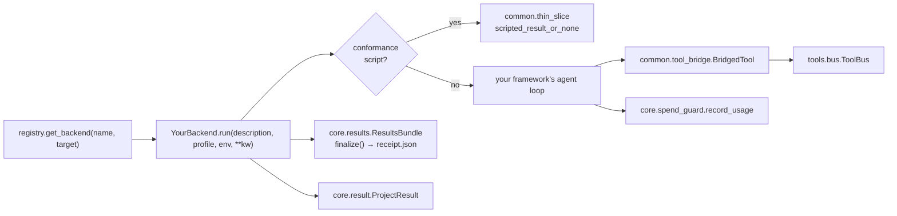
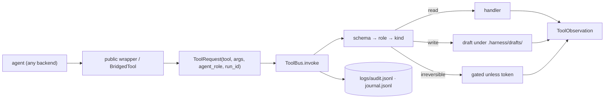

# Extending ai-team

Recipes for the changes contributors make most often. Each one names the files to touch, the
tests that will fail if you miss a step, and the command to prove it. Background:
[ARCHITECTURE.md](ARCHITECTURE.md) for how a run works, [MODULE_MAP.md](MODULE_MAP.md) for
where things live.

One rule covers all of them: **the harness is shared**. A tool, guardrail or role that only
works on one backend breaks the comparison the repo exists to make. If a change is deliberately
backend-specific, say so in the PR and in the doc for that backend.

- [Add a backend](#add-a-backend)
- [Add a tool](#add-a-tool)
- [Add a guardrail](#add-a-guardrail)
- [Add an agent role or a team profile](#add-an-agent-role-or-a-team-profile)
- [Add a failure mode and its check](#add-a-failure-mode-and-its-check)
- [Add or update a spec](#add-or-update-a-spec)
- [Before you open the PR](#before-you-open-the-pr)

## Add a backend

A backend turns a brief and a `TeamProfile` into a `ProjectResult`, using the shared ToolBus,
spend guard and results bundle. Cloud backends start from a spec: see
[cloud-backend-foundation](../.kiro/specs/cloud-backend-foundation/) and the two that depend on
it, [aws-strands-agentcore](../.kiro/specs/aws-strands-agentcore/) and
[azure-agent-framework](../.kiro/specs/azure-agent-framework/). The stubs in
`backends/strands_backend/` and `backends/agent_framework_backend/` are the smallest working
template.



1. **Create the subtree** `src/ai_team/backends/<name>_backend/` with `__init__.py` and
   `backend.py`. The class implements the protocol in
   [`core/backend.py`](../src/ai_team/core/backend.py): a `name` attribute,
   `run(description, profile, env=None, **kwargs) -> ProjectResult` and
   `stream(...) -> AsyncIterator[dict]`. Subclass `ThreadedBackend` to get `stream()` for free
   from a threaded `run()`.
2. **Honour the conformance script first.** The first lines of `run()` are:

   ```python
   scripted = scripted_result_or_none(self.name, description, profile, kwargs)
   if scripted is not None:
       return scripted
   ```

   `tests/conformance/` injects a scripted thin slice through `kwargs["conformance_script"]`
   and checks that every tool call goes through the ToolBus, writes are drafted then committed,
   and spend is recorded. This is how a backend proves it uses the harness before it can call a
   model.
3. **Get tools from the bridge, not from the tool modules.** `backends/common/tool_bridge.py`
   turns the role tool lists in `backends/common/role_tools.py` into `BridgedTool` objects
   (name, description, JSON schema, `call`) that route through `ToolBus.invoke`. Adapt those to
   your framework's tool type, as `strands_backend/tools.py` does. Never call file or shell
   functions directly: FM-001 and FM-012 checks look for writes the bus did not see.
4. **Use the shared run plumbing.** Call `reset_spend_guard(budget, run_id=...)` at the start
   and `record_usage(cost_usd, total_tokens)` after each model call (`core/spend_guard.py`);
   let `BudgetExceededError` propagate. Create a `ResultsBundle(run_id, workspace_dir=...)`,
   write `run.json` and `state.json`, and call `finalize(...)`, which writes `receipt.json`.
   `ensure_workspace_layout()` creates the standard workspace folders. Consume the
   `TeamProfile` roster and phases; do not hard-code a team.
5. **Register it** in [`backends/registry.py`](../src/ai_team/backends/registry.py): add the
   name to `PUBLIC_BACKENDS`, its allowed targets to `_TARGETS`, and a branch in
   `get_backend()` that imports the class lazily. The CLI `--backend` choices come from this
   module. The web dashboard keeps its own list: add an entry to `_BACKEND_CATALOG` in
   `ui/web/routers/catalog.py` (name, label, streaming, required key, targets) when the
   backend should appear there.
6. **Wire the tests.**
   - Add the name to `BACKENDS` in `tests/conformance/conftest.py`.
   - Add the subtree to `_BACKEND_SUBTREES` in `tests/unit/repo/test_import_direction.py` so
     it cannot import another backend's internals.
   - If a module is not reachable from an entry point yet, list it in `DORMANT_MODULES` in
     `tests/unit/repo/test_reachability.py` with the step that activates it.
   - Add unit tests under `tests/unit/backends/`.
7. **Document it.** Add rows for every target to [CLOUD_NATIVE.md](CLOUD_NATIVE.md) (no blank
   cells; `tests/unit/repo/test_cloud_native_status.py` checks), the backend tables in
   [README.md](../README.md) and [MODULE_MAP.md](MODULE_MAP.md), and any new env var in
   [CONFIGURATION.md](CONFIGURATION.md).
8. **Bound every loop.** Any retry path needs the spend guard and a wall-clock limit
   ([CONTRIBUTING.md](../CONTRIBUTING.md#operational-guardrails-timeouts-spend-loops)). A claim
   that the new backend is faster or cheaper needs a batch (`scripts/run_smoke_batch.py`, n≥5).

Prove it:

```bash
uv run pytest tests/conformance -q
uv run pytest tests/unit/repo -q
```

## Add a tool

Every tool that reads, writes, deletes or executes runs through the ToolBus
([`tools/bus.py`](../src/ai_team/tools/bus.py)). The bus validates arguments, checks the
caller's role, stages writes as drafts, gates irreversible actions and appends to
`logs/audit.jsonl` and `logs/journal.jsonl`. A tool that bypasses it is invisible to the
receipt and the evals.



1. **Write the implementation** as a private function in the right module under
   `src/ai_team/tools/` (`file_tools.py`, `code_tools.py`, `git_tools.py`, `test_tools.py`, or
   a role module such as `qa_tools.py`). Validate paths with the existing helpers in
   `file_tools.py`; never use `shell=True`, `eval` or `exec`.
2. **Register a `ToolSpec`** in `register_builtin_tools()` in
   [`tools/catalog.py`](../src/ai_team/tools/catalog.py): a unique `name`, a `kind`
   (`read`, `write`, `irreversible`), a `risk_class` (`low`, `write`, `irreversible`,
   `customer-visible`), a Pydantic `args_schema`, a handler
   `(args, request) -> ToolObservation`, and `allow_roles` if only some roles may call it.
   `kind` decides execution policy; `risk_class` decides which guardrails apply
   ([`tools/kinds.py`](../src/ai_team/tools/kinds.py)).
3. **Expose a public wrapper** that builds a `ToolRequest` and calls `get_bus().invoke(...)`,
   the way `file_tools._invoke` does. CrewAI `@tool` and LangChain wrappers call this wrapper.
4. **Give it to roles.** Add it to the role's list in
   [`backends/common/role_tools.py`](../src/ai_team/backends/common/role_tools.py). CrewAI and
   LangGraph read that map (LangGraph through `tools/langchain_adapter.py`), and new backends
   get it through `tool_bridge.py`. The Claude Agent SDK backend has its own surface: add an
   MCP tool in `claude_agent_sdk_backend/tools/mcp_server.py` and the tool name to the role in
   `claude_agent_sdk_backend/tools/permissions.py`.
5. **Test it** in `tests/unit/tools/` with a normal case and adversarial ones (`..`
   traversal, absolute paths, `.env`, oversized content, wrong role). If it writes, run with
   draft mode on (marker `bus_draft`) and assert nothing lands before `commit_write`.

Prove it:

```bash
uv run pytest tests/unit/tools tests/conformance/test_tool_routing.py -q
```

## Add a guardrail

A guardrail is a pure function that returns a result object. There are two shapes today:
`behavioral.py` and `security.py` return a Pydantic `GuardrailResult` with `status`
(`pass`/`fail`/`warn`), `message`, `details` and `retry_allowed`; `quality.py` returns its own
`GuardrailResult` with `passed`, `score`, `message` and `suggestions`. Use the shape of the
module you add to. Where a guardrail runs depends on the backend, so adding one is two steps:
write it once, then wire it into each backend that should enforce it.

1. **Write it** in `src/ai_team/guardrails/behavioral.py`, `security.py` or `quality.py` and
   export it from [`guardrails/__init__.py`](../src/ai_team/guardrails/__init__.py). Callers
   import from the package, not the module. If it needs a threshold or a switch, add a field to
   `GuardrailSettings` in `config/settings.py` (env prefix `GUARDRAIL_`) and to
   [CONFIGURATION.md](CONFIGURATION.md).
2. **Wire it** where it should run:

   | Backend or path | Where guardrails are called |
   | --- | --- |
   | CrewAI | Task `guardrail=` arguments in `crewai_backend/tasks/*.py`, via the `crewai_*` wrappers in `guardrails/security.py` or `guardrail_to_crewai_callable` |
   | LangGraph | `langgraph_backend/graphs/langgraph_guardrail_nodes.py` (graph nodes with retry routing) and `graphs/guardrail_hooks.py` |
   | Claude Agent SDK | Always-on: `claude_agent_sdk_backend/hooks/security.py` (PreToolUse) and `hooks/quality.py` (PostToolUse). On demand: `run_guardrails` in `tools/mcp_server.py` |
   | Every backend, after the run | `_run_post_run_quality_gates()` in `cli_run.py` (warn-only) |

3. **Test it** in `tests/unit/guardrails/`: one passing case, one failing case, edge cases, and
   adversarial inputs under `tests/unit/guardrails/adversarial/`.
4. **Measure false positives** before you make it blocking. Add labelled cases to the corpus
   in `tests/fixtures/guardrail_corpus/` and run the guardrail evaluation. FM-005 exists
   because a scope check flagged correct QA output.

Prove it:

```bash
uv run pytest tests/unit/guardrails -q
uv run python -m evals.cli guardrail eval
```

Catalogue of existing guardrails: [GUARDRAILS.md](GUARDRAILS.md).

## Add an agent role or a team profile

A role exists in all three working backends or in none.

1. Persona (role, goal, backstory) in
   [`config/agents.yaml`](../src/ai_team/config/agents.yaml). Shared by every backend.
2. Model per tier in `ENV_MODELS` in [`config/models.py`](../src/ai_team/config/models.py)
   ([MODELS.md](MODELS.md)).
3. Tools in `backends/common/role_tools.py` (see [Add a tool](#add-a-tool)).
4. Backend wiring: CrewAI agent in `crewai_backend/agents/` and its crew in `crews/`;
   LangGraph prompt and tools in `langgraph_backend/agents/` and a worker in the phase subgraph
   under `graphs/`; Claude SDK subagent in `claude_agent_sdk_backend/agents/definitions.py`.
5. Add it to the profiles that need it in
   [`config/team_profiles.yaml`](../src/ai_team/config/team_profiles.yaml). A new profile is
   only this step: list its agents and phases.
6. Document it in [AGENTS.md](AGENTS.md) and [TEAM_PROFILES.md](TEAM_PROFILES.md), then run
   `uv run pytest tests/conformance tests/unit/test_team_profile.py -q`.

## Add a failure mode and its check

The eval method is error analysis first: name the failure from real traces, then write a
deterministic check, and only then consider an LLM judge ([EVAL_METHODOLOGY.md](EVAL_METHODOLOGY.md)).

1. Add the failure mode to
   [`evals/taxonomy/failure_modes.yaml`](../evals/taxonomy/failure_modes.yaml) with the next
   `FM-0NN` id and the layer it belongs to.
2. Write the check in the matching module under `evals/checks/`, decorated with
   `@check(id="CHK-…", failure_mode_id="FM-0NN", tier="A")`. It takes a `Trace` and returns
   `passed(...)`, `failed(...)` or `na(...)` from `evals/checks/base.py`. A new module must be
   imported in `ensure_checks_loaded()` in `evals/checks/registry.py`.
3. Commit three fixtures: `evals/fixtures/traces/CHK-…__pass.json`, `__fail.json` and
   `__na.json`. `evals/fixture_contract.py` fails the suite if one is missing or returns the
   wrong outcome. Redact them (`evals.cli fixtures redact --lint`).
4. Add unit tests in `tests/unit/evals/`.

Prove it:

```bash
uv run python -m evals.cli checks validate
uv run python -m evals.cli run --tier A --warn-only
```

`--warn-only` keeps the exit code at 0 while the gate is advisory; read
[EVAL_GATE_STATUS.md](EVAL_GATE_STATUS.md) before you quote a Tier A verdict.

## Add or update a spec

Feature work is planned in `.kiro/specs/<id>/`. Full rules:
[`.cursor/rules/kiro-specs.mdc`](../.cursor/rules/kiro-specs.mdc).

1. Create `.kiro/specs/<id>/requirements.md`, `design.md` and `tasks.md`. A spec `README.md`
   is optional.
2. Start `requirements.md` with the header fields the register reads:

   ```markdown
   **Spec ID:** `<id>`
   **Status:** Draft
   **Created:** YYYY-MM-DD
   **Depends on:** [`../other-spec/`](../other-spec/)
   ```

   `Status` starts with `Draft`, `In progress`, `Done` or `Replaced by`.
3. Regenerate the register. Do not edit the table in `.kiro/specs/README.md` by hand.

   ```bash
   uv run python scripts/spec_index.py --write
   uv run python scripts/spec_index.py --check
   ```

4. While implementing, tick a box in `tasks.md` only when its Definition of done is literally
   true. Leave human-triggered spend tasks open.

Link specs from docs; do not copy their requirements into `docs/`.

## Before you open the PR

```bash
uv run ruff format .
uv run ruff check .
uv run mypy src/ai_team
uv run pytest tests/unit tests/conformance -q
./scripts/pre_push_check.sh
```

`tests/unit/repo/` fails on dead relative links, a new top-level package missing from the
README tree, imports in the wrong direction, unreachable modules and type or complexity
regressions. Branching, commit messages and the evidence a comparison claim needs:
[CONTRIBUTING.md](../CONTRIBUTING.md).
