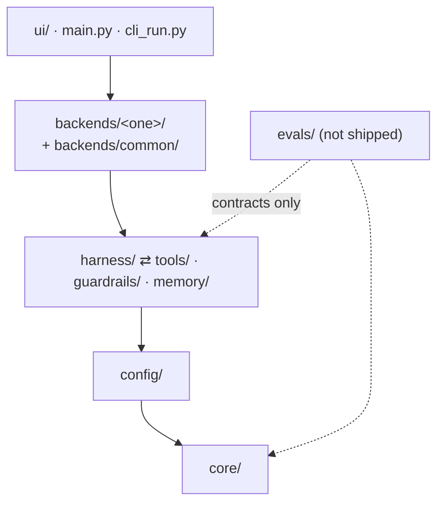

# Module map

Where everything lives, what each package owns, and which way imports may point. Read
[ARCHITECTURE.md](ARCHITECTURE.md) first for how the pieces work together at run time.

## Top level

| Path | What it holds | Shipped in the wheel? |
| --- | --- | --- |
| `src/ai_team/` | The application: backends, harness, tools, guardrails, web UI | Yes |
| `evals/` | Trace model, failure taxonomy, deterministic checks, judges, tiers, OTLP export | No |
| `tests/` | Unit, conformance, integration, e2e, performance | No |
| `scripts/` | Demo runner, smoke batches, pre-push gate, spec register | No |
| `demos/` | Briefs with an acceptance contract: `00_smoke_test`, `02_todo_app` | No |
| `docker/` | Web UI image, cloud-backend images, compose file with optional profiles | No |
| `infra/terraform/` | AWS (`aws/`) and Azure (`azure/`) modules and `envs/dev` for the cloud backends | No |
| `.kiro/specs/` | Feature specs: `requirements.md` → `design.md` → `tasks.md` | No |
| `.cursor/rules/` | Editor-agent rules (`*.mdc`): style, security, testing, specs, CI | No |
| `docs/` | This documentation ([map](README.md)) | No |
| `course/` | *Agents That Actually Work*, the six-week course | No |
| `workspace/`, `output/`, `logs/`, `data/` | Run state written at run time; gitignored except `data/.gitkeep` | No |

`src/ai_team` must never import `evals` (`tests/unit/repo/test_import_direction.py`), so a run
never depends on eval code.

## `src/ai_team/` packages

| Package | Owns | Key modules |
| --- | --- | --- |
| `main.py`, `cli_run.py`, `__main__.py` | `ai-team` CLI: argument parsing, run dispatch, post-run gates | `cli_run.execute_run`, `_run_post_run_quality_gates` |
| `core/` | Backend-neutral contracts: the `Backend` protocol, `ProjectResult`, team profiles, spend guard, run naming, workspace layout, results bundle | `backend.py`, `result.py`, `team_profile.py`, `spend_guard.py`, `workspace_layout.py`, `results/writer.py` (`ResultsBundle`), `results/cleanup.py`, `run_store.py`, `flow_wiring.py` |
| `config/` | Settings and model routing: Pydantic Settings, per-tier models, agent personas, team profiles, task routes, cost estimate, token tracking | `settings.py`, `models.py`, `agents.yaml`, `tasks.yaml`, `team_profiles.yaml`, `task_routes.yaml`, `cost_estimator.py`, `llm_factory.py` |
| `harness/` | The parts that make runs comparable and recoverable: acceptance list, pinned context, receipt, journal, lessons loop, QA verdicts, routing, telemetry, verifiers | `acceptance.py`, `context.py`, `receipt.py`, `journal.py`, `lessons_loop.py`, `router.py`, `telemetry.py`, `verifiers.py`, `contracts.py`, `session_loop.py` (dormant), `otel_tags.py` |
| `tools/` | The ToolBus and every tool behind it: file, code, git, test, smoke, role tools | `bus.py`, `kinds.py`, `draft.py`, `catalog.py`, `file_tools.py`, `smoke_tools.py`, `*_tools.py`, `langchain_adapter.py` |
| `guardrails/` | Behavioral, security and quality validators. Import from the package facade | `behavioral.py`, `security.py`, `quality.py`, `legacy.py` (class API used by CrewAI), `corpus_metrics.py` |
| `memory/` | Long-term SQLite store, lessons extraction, self-improvement wiring | `memory_config.py` (`LongTermStore`), `lessons.py`, `self_improvement_runtime.py` |
| `models/` | Shared Pydantic domain types: requirements, architecture, development, QA, comparison report | `requirements.py`, `architecture.py`, `development.py`, `qa_models.py` |
| `reports/` | Manager self-improvement report written after a run | `manager_self_improvement.py` |
| `knowledge/` | Markdown snippets (patterns, best practices, framework guides) for agent context | — |
| `monitor.py` | `TeamMonitor`: thread-safe event collector shared by the web UI and the `--monitor` CLI view | — |
| `backends/` | Registry plus one subtree per backend; see below | `registry.py`, `comparison.py` |
| `ui/` | FastAPI control plane, routers, artifact browser, React/Vite frontend. `ui/tui/` is empty | `web/server.py`, `web/auth.py`, `web/routers/*.py`, `artifacts/service.py`, `web/frontend/` |

### `src/ai_team/backends/`

| Subtree | Status | Entry | Inside |
| --- | --- | --- | --- |
| `registry.py` | — | `get_backend(name, target=)` | Names, aliases (`claude-sdk`), allowed targets per backend |
| `common/` | Shared by every backend | — | `targets.py` (`ExecutionTarget`, `FakeRemoteBackend`), `thin_slice.py` (conformance replay), `tool_bridge.py` (`BridgedTool`), `role_tools.py`, `roles.py`, `acceptance.py` |
| `crewai_backend/` | Runs; comparison datapoint | `CrewAIBackend` | `agents/`, `crews/`, `tasks/`, `flows/` (`AITeamFlow`, `ProjectState`), `callbacks.py`. Runs in a subprocess with a hard kill |
| `langgraph_backend/` | Runs | `LangGraphBackend` | `graphs/main_graph.py`, phase subgraphs, `routing.py`, `state.py`, `checkpointer.py`, `agents/` (prompts, tools) |
| `claude_agent_sdk_backend/` | Runs | `ClaudeAgentBackend` | `orchestrator.py`, `agents/` (definitions, prompts, builder), `hooks/` (security, quality, audit), `tools/mcp_server.py`, `tools/permissions.py`, `costs.py`, `recovery.py` |
| `strands_backend/` | Stub; [aws-strands-agentcore](../.kiro/specs/aws-strands-agentcore/) | `StrandsBackend` | `run()` raises `NotImplementedError` except under a conformance script; `tools.py` adapts `BridgedTool` |
| `agent_framework_backend/` | Stub; [azure-agent-framework](../.kiro/specs/azure-agent-framework/) | `AgentFrameworkBackend` | Same shape as Strands |

`get_backend("strands")` and `get_backend("agent-framework")` raise `NotImplementedError` naming
their spec before anything is spent.

## Import direction

What `tests/unit/repo/test_import_direction.py` enforces today:

| Rule | Scope |
| --- | --- |
| Never import `ai_team.backends` | `core/`, `config/`, `harness/`, `tools/`, `guardrails/`, `memory/`, and all of `evals/` |
| Never import `ai_team.ui` | `core/`, `config/`, `harness/`, `tools/`, `guardrails/`, `memory/` |
| Import only your own backend subtree | `crewai_backend/`, `langgraph_backend/`, `claude_agent_sdk_backend/` |
| Never import `evals` | all of `src/ai_team/` |

The intended layering, from the
[production-hardening design §4](../.kiro/specs/production-hardening/design.md) table:

`harness/`, `tools/`, `guardrails/` and `memory/` sit on one layer and may import each other.
`models/` holds shared types and is imported from every layer above `core/`.

The code has a few edges that break the design table. They pass the test because they are lazy
(inside a function) or between packages the test does not police:

| Edge | Where | Kind |
| --- | --- | --- |
| `core` → `harness` | `core/results/writer.py` (context, receipt, lessons, telemetry) | lazy |
| `config` → `harness` | `config/token_tracker.py` → `harness/context_pressure.py` | lazy |
| `backends/common` → `langgraph_backend` | `common/roles.py` imports `langgraph_backend.agents.prompts` | module-level |
| `reports` → `langgraph_backend` | `reports/manager_self_improvement.py` (chat model) | lazy |

New imports follow the diagram. Do not add rows to this table.

## `evals/`

| Path | Owns |
| --- | --- |
| `cli.py` | `python -m evals.cli`: `trace`, `index`, `checks`, `run`, `taxonomy`, `guardrail`, `judge`, `drift`, `coverage`, … |
| `trace/` | `Trace` model (`models.py`), builder from a run, workspace parsers, schema migrations, OTLP export/import (`otel_export.py`, `otel_run.py`, `otel_import.py`) |
| `taxonomy/` | `failure_modes.yaml` (FM-001…017) and its loader |
| `checks/` | Deterministic checks, one module per layer, registered by decorator in `registry.py` |
| `judges/` | Binary, versioned LLM judges and their on-disk cache |
| `tier_a.py`, `gate.py`, `baselines/` | Tier A offline replay and the regression gate |
| `arms/` | Comparison arms (ai_team, solo, reference) and ladder sweeps |
| `fixtures/`, `corpora/`, `golden/`, `scenarios/` | Committed inputs for checks, guardrail corpora, labelling sets, live scenarios |
| `run_evals.py` | Live (paid) eval runner for Tiers B/C |

Entry point and method: [evals/README.md](../evals/README.md), [EVAL_METHODOLOGY.md](EVAL_METHODOLOGY.md).

## `tests/`

| Folder | Runs in CI | Needs keys | What it proves |
| --- | --- | --- | --- |
| `unit/` | Every push | No | Module behaviour. `unit/repo/` guards repository invariants: dead links, import direction, reachability, README tree, type and complexity ratchets |
| `conformance/` | Every push | No | The backend contract. Each backend replays one scripted thin slice through the ToolBus; see `conftest.py` `BACKENDS` |
| `integration/` | `main` pushes | Only with `AI_TEAM_USE_REAL_LLM=1` (marker `real_llm`) | Crews, graphs, memory, OTel stack (`AI_TEAM_DOCKER_TESTS=1`) |
| `e2e/` | `web/` only (mocked, no LLM) | Yes for `test_e2e_hello_world.py` | Full runs; Playwright web E2E |
| `performance/` | No | — | Benchmarks ([PERFORMANCE.md](PERFORMANCE.md)) |
| `fixtures/` | — | — | Shared inputs: mini workspace, parser samples, smoke-batch recordings |

## `scripts/`

| Script | Use |
| --- | --- |
| `run_demo.py` | Run one demo brief on one backend (`--graph-mode placeholder` for $0) |
| `quickstart.sh` | Smoke every backend you have keys for |
| `run_smoke_batch.py`, `batch_stats.py` | n-run batches with Wilson intervals; `--replay` for $0 |
| `compare_backends.py` | Same demo across backends, one report |
| `local_smoke.py` | Thin slice against a local Ollama model (`make local-smoke`) |
| `role_cost.py` | Tokens per role for a run or batch |
| `pre_push_check.sh`, `ci_check.sh`, `ci_unit_test.sh`, `pip_audit.sh` | Local mirrors of CI gates |
| `spec_index.py` | Regenerate or check the spec register in `.kiro/specs/README.md` |

## `docker/` and `infra/`

| Path | Use |
| --- | --- |
| `docker/Dockerfile` | Web UI image (React build + FastAPI) |
| `docker/strands.Dockerfile`, `docker/agent-framework.Dockerfile` | Placeholder images for the cloud backends |
| `docker/docker-compose.yml` | `app` service plus profiles: `observability` (collector, Aspire, Phoenix), `local-llm` (Ollama), `strands`, `agent-framework` |
| `docker/otel-collector.yaml` | Collector config for local trace viewing ([observability](observability/README.md)) |
| `infra/terraform/aws/modules/` | AgentCore runtime, ECR, IAM role, artifacts bucket, Bedrock guardrail, budget, observability |
| `infra/terraform/azure/modules/` | Foundry, model deployment, Container Apps job, identity/RBAC, Key Vault, storage, budget, observability |

Status of each backend on each target: [CLOUD_NATIVE.md](CLOUD_NATIVE.md). Decision record:
[ADR-001](adr/ADR-001-cloud-native-backends.md). AWS options and costs:
[AWS_BACKEND_ARCHITECTURE.md](AWS_BACKEND_ARCHITECTURE.md).

## Per-run directories

Every run gets a run id (for example `2026-10-19_102648_write-a-single-python-module_01`, from
`core/run_naming.py`) and two folders with that name.

**Workspace** `workspace/<run_id>/`: the agents' working copy. Agents hand work to each other
through these files, not through shared memory.

| Path | Written by | Contents |
| --- | --- | --- |
| `docs/` | agents + harness | `project_brief.md`, requirements and architecture docs, `CONSTRAINTS.md`, `STATE.md`, `LESSONS.md`, `lessons.jsonl`, `qa_verdicts.jsonl`, `contracts/`, `CLAUDE_PROFILE.md` (Claude SDK) |
| `src/`, `tests/`, `infrastructure/`, `.github/workflows/` | agents | The generated application, its tests, IaC and CI |
| `logs/` | harness | `audit.jsonl` (every ToolBus call), `journal.jsonl`, `phases.jsonl`, `costs.jsonl`, `harness_acceptance.json`, `session.json` and `reasoning.jsonl` (Claude SDK) |
| `.harness/drafts/` | ToolBus | Staged writes waiting for `commit_write` |

`core/workspace_layout.py` creates the standard folders. Not every backend writes every log.

**Bundle** `output/runs/<run_id>/`: the record of the run, written by `ResultsBundle` and the
harness. `receipt.json` is the source of truth for cost, files and smoke results; the dashboard
reads it. Layout and field list: [RUN_ARTIFACTS.md](RUN_ARTIFACTS.md).

## Where to change what

| You want to change… | Start in |
| --- | --- |
| Which agents a profile uses | `config/team_profiles.yaml` ([TEAM_PROFILES.md](TEAM_PROFILES.md)) |
| An agent's persona | `config/agents.yaml` ([AGENTS.md](AGENTS.md)) |
| Which model a role uses | `config/models.py` ([MODELS.md](MODELS.md)) |
| A setting or env var | `config/settings.py`, `config/models.py` ([CONFIGURATION.md](CONFIGURATION.md)) |
| What a tool does or who may call it | `tools/catalog.py`, `tools/*_tools.py`, `backends/common/role_tools.py` |
| A validation rule | `guardrails/` ([GUARDRAILS.md](GUARDRAILS.md)) |
| What gets recorded about a run | `core/results/writer.py`, `harness/receipt.py` |
| A REST or WebSocket endpoint | `ui/web/routers/` |
| A failure mode or check | `evals/taxonomy/failure_modes.yaml`, `evals/checks/` |

Step-by-step recipes: [EXTENDING.md](EXTENDING.md).
