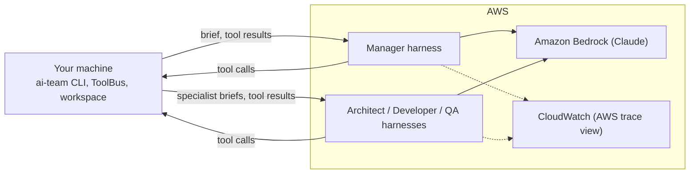

# AgentCore Harness backend — user guide

> **Status:** written ahead of the build. It describes the `agentcore-harness` backend as
> specified in [`.kiro/specs/aws-agentcore-harness/`](../../.kiro/specs/aws-agentcore-harness/).
> The commands below will not work until that spec is complete. Task 3.5 checks every step
> against the real thing and removes this banner.

## What this backend is

`agentcore-harness` runs the ai-team thin slice (manager → architect → developer → QA) with
**AWS running the agent loop and your machine running the tools.**

- Each role is an **AgentCore Harness**: an agent defined by configuration (model, system
  prompt, tools, limits) that AWS runs for you. There is no orchestration code to host.
- Every tool call comes back to your machine. ai-team runs it through ToolBus, exactly as the
  other backends do: writes are staged as drafts, phases are committed only after guardrails
  pass, and every call is in `logs/audit.jsonl`.
- The model is Claude on Amazon Bedrock, the same model ids as the `strands` backend and the
  Bedrock rows of the other backends, so results are directly comparable.



**When to use it:** to compare a configuration-only AWS agent against the hand-built backends
on the same task. For local runs at $0, use `--backend strands` with Ollama instead; this
backend only runs in the cloud.

## Before you start

You need:

- the ai-team repo set up as in [`docs/GETTING_STARTED.md`](../GETTING_STARTED.md) (`uv sync`);
- an AWS account you can use for development, with the AWS CLI v2 installed;
- Terraform 1.10 or later;
- a monthly budget you're comfortable with. The defaults alert at $12.50 and $25.

A thin-slice run usually costs **about $1–2** (almost all of it model tokens). Nothing bills
while you're not running; the harness definitions themselves are free to keep.

## One-time setup

### 1. Create an AWS profile

Use SSO if your account has it, otherwise an IAM user, in a dev account:

```bash
aws configure sso --profile ai-team      # or: aws configure --profile ai-team
aws sts get-caller-identity --profile ai-team
```

The second command should print your account id. ai-team reads credentials from this profile;
never put AWS keys in `.env`.

### 2. Turn on Claude in Bedrock

In the Bedrock console (region `us-east-1`), submit Anthropic's one-time use-case form if the
account hasn't already. Then check that the model answers:

```bash
aws bedrock-runtime converse --profile ai-team --region us-east-1 \
  --model-id <manager model id from config> \
  --messages '[{"role":"user","content":[{"text":"ping"}]}]'
```

### 3. Deploy the harnesses

Generate the prompts and tool lists from the code, so AWS gets exactly what ai-team uses:

```bash
uv run ai-team harness export-tools
```

Then deploy:

```bash
cd infra/terraform/aws/envs/dev
cp terraform.tfvars.example terraform.tfvars     # set alert_email, owner
terraform init -backend-config=backend.hcl       # or plain `terraform init` for local state
terraform plan  -var enable_agentcore_harness=true
terraform apply -var enable_agentcore_harness=true
terraform output -json harness_config > ../../../../../config/harness.dev.json
cd -
```

`plan` shows four harnesses (manager, architect, developer, qa), their endpoints, two IAM
roles, a log group and a budget. Read it before you apply.

### 4. Point ai-team at it

Add to `.env`:

```bash
AWS_PROFILE=ai-team
AI_TEAM_HARNESS_CONFIG_PATH=config/harness.dev.json
AI_TEAM_RUN_BUDGET_USD=1.50       # hard stop per run; raise it for bigger briefs
```

## Run it

```bash
uv run ai-team run --backend agentcore-harness --target cloud \
  "Create calc.py with add(a, b) and a pytest test."
```

What you'll see in the terminal:

1. the run id and the results folder;
2. one line per role as it starts (`manager`, then each specialist the manager calls);
3. each tool call as it runs on your machine (`write_file`, `run_tests`, ...);
4. each phase commit: `committed` or `refused` with the reason;
5. a final summary: status, accepted criteria, tokens, cost, wall-clock time.

Runs stop automatically when they hit the budget (`budget_exceeded`), the time limit
(`timeout`), or the manager finishes. If the manager stops before committing every phase,
ai-team asks it to finish, up to two times, then ends the run as `failed` with the missing
phase named.

Only `--target cloud` is supported. `local` and `container` stop immediately with a message;
use `--backend strands` for those.

## Read the results

Everything lands in `output/runs/<run_id>/`, in the same layout as every other backend:

| Path | What it is |
| --- | --- |
| `receipt.md` | Human-readable summary: status, phases, accepted criteria, cost |
| `run.json` | Machine-readable results bundle (backend, model ids, harness versions, truncation setting) |
| `artifacts/` | The code the team produced (from your local workspace) |
| `logs/audit.jsonl` | One row per tool call, written by ToolBus |
| `logs/costs.jsonl` | Spend per role, priced from Bedrock token counts |
| `logs/harness_acceptance.json` | Which acceptance criteria passed, failed or stayed unverified |

To compare with other backends on the same brief, use the web UI's Compare view or the eval
tools, exactly as for local runs.

### The AWS view

Each run also appears in CloudWatch under the AgentCore / GenAI observability pages (menu names
may vary), as sessions named after the run id. That is AWS's account of the run. ai-team's own
record in `logs/` is the one the evals score. If the two disagree (for example, a different
number of tool calls), treat it as something to look into.

## Change a prompt or a tool

Harness prompts and tool lists come from the repo. After changing a role's prompt in
`common/roles.py` or adding a tool to a role:

```bash
uv run ai-team harness export-tools
cd infra/terraform/aws/envs/dev
terraform plan  -var enable_agentcore_harness=true    # shows a new harness version
terraform apply -var enable_agentcore_harness=true
terraform output -json harness_config > ../../../../../config/harness.dev.json
```

Each harness uses a named endpoint pinned to a version, so a run never picks up a change you
haven't applied. The version used is recorded in every `run.json`. If the tools in your code
and the tools in the deployed harness don't match, the run stops before spending anything and
tells you to re-run the steps above.

## Costs and limits

| Control | Default | Where |
| --- | --- | --- |
| Per-run budget (hard stop) | $1.50 | `AI_TEAM_RUN_BUDGET_USD` |
| Monthly budget alerts | $12.50 and $25 | `terraform.tfvars` (`monthly_budget_usd`) |
| Real-time spend alarm | on | CloudWatch alarm on Bedrock token counts |
| Max steps per role session | 40 | Terraform module `limits` |
| Session timeout | 900 s per invocation | Terraform module `limits` |
| Follow-ups when a phase is left uncommitted | 2 | `AI_TEAM_HARNESS_MAX_GATE_RETRIES` |

Budget emails can lag by hours. The per-run budget is the guard that actually stops spend.

## Tear it down

When you're done for the day or the experiment:

```bash
cd infra/terraform/aws/envs/dev
terraform destroy -var enable_agentcore_harness=true
cd -
infra/scripts/teardown_check.sh aws
```

The check should report 0 billable resources. Local results in `output/runs/` are kept;
prune old ones with `uv run ai-team prune --older-than-days 14`.

## Troubleshooting

| Symptom | Likely cause | Fix |
| --- | --- | --- |
| `no harness config` before anything runs | `AI_TEAM_HARNESS_CONFIG_PATH` missing or file not written | Re-run the `terraform output -json harness_config` step |
| `tool list mismatch` before anything runs | Code changed since the last deploy | Run `export-tools`, `plan`, `apply`, write the config again |
| `AccessDeniedException` on the first model call | Use-case form not submitted, or the IAM role is missing the inference profile or its underlying models | Check setup step 2; re-apply Terraform |
| `ExpiredToken` / SSO errors | SSO session expired | `aws sso login --profile ai-team` |
| Run ends `failed: phase_not_committed:<phase>` | The manager stopped without committing that phase, even after two reminders | Expected behaviour; look at the manager's last turns in `logs/` and the CloudWatch session |
| Run ends `budget_exceeded` early | Budget too low for the brief | Raise `AI_TEAM_RUN_BUDGET_USD` for that run |
| Every tool call is slow | Each tool call is a round trip between AWS and your machine | Expected; the round-trip time is recorded in the results and compared in `docs/CLOUD_NATIVE.md` |
| Nothing in CloudWatch | Transaction Search not enabled, or a few minutes' delay | Re-apply the `observability` module; wait a few minutes |
| `teardown_check.sh` lists resources after destroy | Something was created outside Terraform, or destroy was interrupted | Re-run `terraform destroy`; remove anything left by hand and note it |

## Good to know

- **Where your code runs:** on your machine, like the local backends. AWS never sees the
  workspace, only prompts and tool results.
- **What AWS keeps:** prompts and tool results pass through the harness session and appear in
  logs (14-day retention). Harness memory is off, so nothing carries over between runs. Don't
  run briefs containing secrets.
- **No built-in shell:** the harnesses' own shell and file tools are disabled, so every file
  change goes through ToolBus and shows up in the audit log.
- **Lessons:** ai-team's lessons from earlier runs are added to the manager's instructions at
  the start of each run, the same way as for the other backends.
- **Region:** `us-east-1` by default. The model profiles keep processing in US regions.
