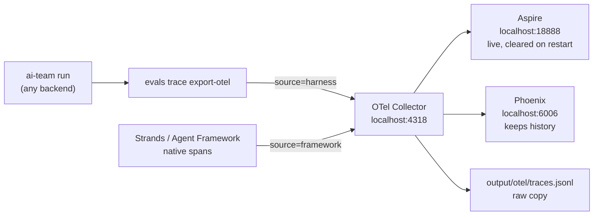
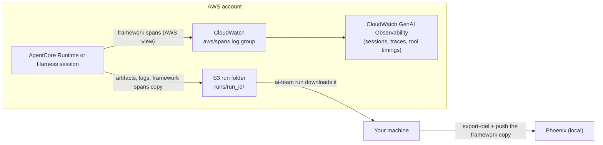
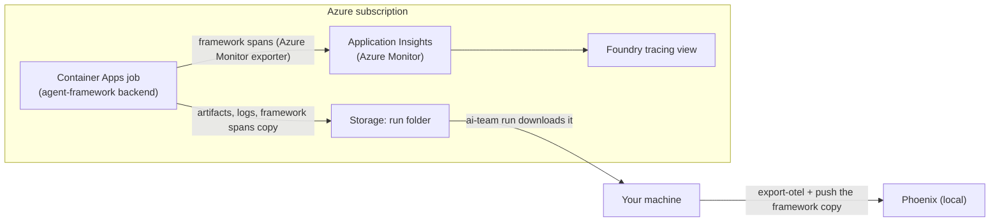

# Viewing traces: local, AWS, Azure

> **Status:** written ahead of the build, for [`.kiro/specs/otel-observability/`](../../.kiro/specs/otel-observability/).
> Each section says whether it has been checked against a real run. Commands in unchecked
> sections may not work yet.

A **trace** is the step-by-step record of one run: every agent, every model call, every tool
call, with timings and token counts. This guide shows how to look at traces for any ai-team
backend, on your machine first, then in AWS and Azure.

## The pieces, in one line each

| Piece | What it is |
| --- | --- |
| **OpenTelemetry (OTel)** | The open standard for recording what software did, readable by almost every monitoring tool |
| **OTLP** | OTel's format for sending that data; here it's JSON over HTTP to port 4318 |
| **GenAI names / OpenInference names** | Two agreed sets of attribute names for model, tool and agent steps. ai-team writes both: Aspire and the clouds read the first, Phoenix the second |
| **OTel Collector** | A small relay that receives spans and forwards them to every viewer, plus a raw file |
| **Aspire dashboard** | A live viewer from Microsoft; fast, but forgets everything on restart |
| **Phoenix** | An LLM-focused viewer from Arize; keeps history and shows model calls, tokens and tool calls |
| **`export-otel`** | The ai-team command that turns a run's own record into OTel |
| **`import-otel`** | The reverse: reads OTel back into ai-team's format, for comparing sources |

Why these, and what was considered instead: [design §0 of the spec](../../.kiro/specs/otel-observability/design.md#0-components-and-why-each-was-chosen).

## Two accounts of every run

| Source | Written by | Available for | Used for |
| --- | --- | --- | --- |
| `harness` | ai-team itself (ToolBus audit, phases, spend, QA) | all backends | scoring, and the main view |
| `framework` | the agent framework or cloud service (Strands, Agent Framework, AgentCore, Azure) | `strands`, `agent-framework`, `agentcore-harness`, and cloud runs | a second opinion |

Every span carries `ai_team.source` set to `harness` or `framework`. When the two disagree on
the same run (say the framework reports more tool calls than ToolBus audited), something went
around the harness, and that's worth investigating.

---

## Local

> **Not yet checked** (task 3.1).

### What runs



- **Aspire** is for watching a run as it happens. It forgets everything when it restarts.
- **Phoenix** is for comparing runs and backends. Everything lands in one project, `ai-team`.
  Its data is kept in `output/phoenix/`.
- The **raw file** is there whatever viewer you use.
- All of it listens on `127.0.0.1` only. The viewers have no login, so they aren't reachable
  from other machines on your network.

### Start it

You need Docker running.

```bash
make otel-up            # collector + Aspire + Phoenix
# live:     http://localhost:18888
# history:  http://localhost:6006
```

### Send runs to it

For one run, or for everything already on disk:

```bash
uv run python -m evals.cli trace export-otel output/runs/<run_id> --endpoint http://localhost:4318
make otel-backfill      # every run in output/runs/ not exported yet
```

If the stack isn't running, export still writes `logs/otel.harness.jsonl` into the run folder,
records `written_only` in `logs/otel.export.json`, and prints a warning. `make otel-backfill`
later sends every run whose last export wasn't `posted`.

*Later (optional):* with `AI_TEAM_OTEL_EXPORT=1`, every run will export itself when it ends
(spec Phase 4). Until then, run the backfill after a batch.

Strands and Agent Framework containers also send their own spans straight to the collector:

```bash
docker compose -f docker/docker-compose.yml --profile observability --profile strands up -d
uv run ai-team run --backend strands --target container "<brief>"
```

### Find what you want in Phoenix

| To see | Filter |
| --- | --- |
| One run, both sources | `ai_team.run_id = "<run id>"` |
| One backend | `ai_team.backend = "crewai"` (or `langgraph`, `claude-agent-sdk`, `strands`, `agent-framework`, `agentcore-harness`) |
| Only ai-team's record | `ai_team.source = "harness"` |
| Model calls only | `gen_ai.operation.name = "chat"` |
| Failed tool calls | span status = error and `gen_ai.operation.name = "execute_tool"` |

To compare backends, run the same brief on each and filter by backend one at a time, or sort
by `ai_team.backend`.

Prompts, model replies, tool arguments and tool results (which include whole files written and
test output) are **left out** by default. Spans keep names, sizes and a hash, so you can still
see that two runs wrote the same file. Add `--with-content` to `export-otel` when you need the
text for debugging. Each value is then cut to 2 KB, and it sits in `output/phoenix/` until you
delete it.

### Stop it

```bash
make otel-down          # Phoenix history is kept in output/phoenix/
```

### Troubleshooting

| Symptom | Fix |
| --- | --- |
| Nothing in either viewer | Is the stack up (`docker ps`)? Export prints the endpoint it used; it should be `http://localhost:4318` |
| In Aspire but not Phoenix | Check `docker logs` for the collector; the Phoenix exporter line will show the error |
| Aspire is empty after a restart | Expected. Use Phoenix for anything older than the current session |
| A run has no model token counts | Some backends record spend per run, not per call; those spans carry `ai_team.tokens_missing = true` |
| Phoenix shows spans but no model or tool views | The spans lack OpenInference names; re-export with the current `export-otel` |
| Backfill skipped some runs | Old runs that can't be rebuilt are listed at the end; they're skipped, not broken |

---

## AWS

> **Not yet checked** (task 3.2; needs a cloud run from `aws-strands-agentcore` 4.2 or
> `aws-agentcore-harness` 3.1).

### Where traces go



AgentCore sends its own (framework) spans to CloudWatch automatically. The `strands` backend
also writes a copy into the run's S3 folder, which `ai-team run` downloads with the rest of
the results.

### Look at a run in AWS

1. Make sure **Transaction Search** is on for the account (the `observability` Terraform module
   turns it on).
2. Open the CloudWatch console in the run's region, then **GenAI Observability** →
   **Bedrock AgentCore** (menu names may differ slightly).
3. Find the session named after the run id. You'll see the agent steps, model calls with
   tokens, and tool calls with timings.
4. For a query instead, open **Logs Insights** on the `aws/spans` log group:

   ```
   fields @timestamp, name, durationNano
   | filter resource.attributes.ai_team.run_id = "<run id>"
   | sort @timestamp asc
   ```

   Field paths can differ by version; open one span first and adjust the filter to match.

To view these pages you need read access to CloudWatch Logs and X-Ray (for example the
`CloudWatchReadOnlyAccess` and `AWSXrayReadOnlyAccess` managed policies) in that account.

### Bring an AWS run back to your machine

After a cloud run finishes, its folder is already in `output/runs/<run_id>/`:

```bash
make otel-up
uv run python -m evals.cli trace export-otel output/runs/<run_id> --endpoint http://localhost:4318   # harness view
curl -s -X POST http://localhost:4318/v1/traces -H 'Content-Type: application/json' \
  --data-binary @output/runs/<run_id>/logs/otel.framework.json                       # AWS view
```

Both now sit side by side in Phoenix under the same `ai_team.run_id`.

### Cost note

CloudWatch charges for span and log data stored, and there's no cap. Prompt content is left
out of AgentCore spans by default; keep it that way outside short debugging sessions. Log
retention is 14 days in the dev Terraform.

---

## Azure (later)

> **Later:** checked when `azure-agent-framework` has a cloud run (task 3.3).

### Where traces go



Agent Framework emits OpenTelemetry, and the Azure Monitor exporter sends it to Application
Insights. Foundry shows the same traces in its own tracing page.

### Look at a run in Azure

1. In the Azure portal, open the Application Insights resource from the Terraform outputs.
2. **Transaction search**: filter by the custom property `ai_team.run_id`, then open the
   **end-to-end transaction** view for the agent's top span.
3. For a query, open **Logs** and run:

   ```kusto
   union dependencies, requests
   | where tostring(customDimensions["ai_team.run_id"]) == "<run id>"
   | project timestamp, name, duration, success, customDimensions
   | order by timestamp asc
   ```

   Model and tool spans usually land in `dependencies`. Check one row first if the filter finds
   nothing.

Reading these needs the **Monitoring Reader** role (or Log Analytics Reader) on the resource.

### Bring an Azure run back to your machine

Same as AWS: once the run folder is downloaded to `output/runs/<run_id>/`, run `export-otel`
for the harness view and POST `logs/otel.framework.json` for the Azure view.

---

## Other viewers

Anything that reads OTLP can sit behind the same collector: Jaeger (good for comparing two
traces), Grafana with Tempo (dashboards across many runs), or a hosted tool. Add an exporter to
`docker/otel-collector.yaml`. None of them is used for scoring; `evals/` scores from
ai-team's own records.
